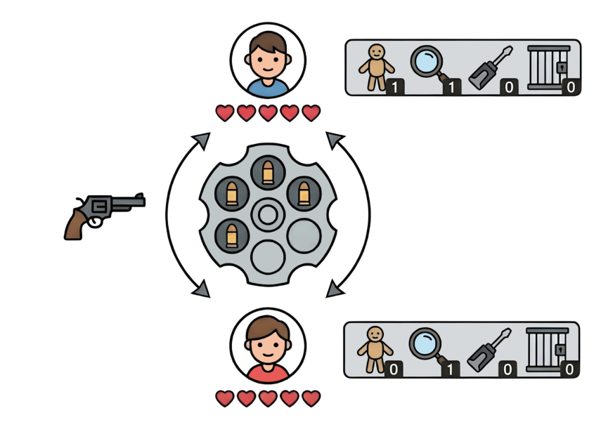

## 题目描述

时间限制：15.0 秒；内存限制：2048 MB。

<em>本题是一道交互题。</em>记得在每次输出后刷新输出缓冲区。你可以使用以下方式刷新输出：

-   在 C/C++ 中使用 `fflush(stdout)` 或 `cout.flush()`；
-   在 Java 和 Kotlin 中使用 `System.out.flush()`；
-   在 Python 中使用 `sys.stdout.flush()`。

  
由 Nano Banana Pro 绘制的游戏概念图。

你正在参加一场名为<em>左轮轮盘赌（Revolver Roulette）</em>的策略回合制游戏。

游戏开始时，左轮手枪中装填了恰好 $6$ 发子弹。每发子弹独立地以相等概率为<em>实弹（live）</em>或<em>空包弹（blank）</em>。双方玩家始终知道弹巢中当前剩余的实弹和空包弹数量，但不知道它们的具体排列顺序。

每位玩家初始拥有 $5$ 点生命值（HP）和 $2$ 件道具。如果一名玩家的 HP 降至 $0$ 或以下，该玩家即被淘汰，另一名玩家获胜。双方玩家轮流执行行动。

### 回合流程

在自己的回合中，当前行动玩家可以执行任意次数的以下行动：

-   使用任意道具。
-   执行任意射击行动。

只有当一次射击行动导致回合移交给对方玩家，或者有玩家被淘汰时，当前回合才会结束。

### 射击行动

当前行动玩家必须从以下射击行动中选择一种：

-   `Fire at Opponent`（向对手开枪）：当前玩家向对方玩家射出下一发子弹。如果是实弹，对方玩家失去 $1$ 点 HP。无论子弹类型如何，回合都会移交给对方玩家。
-   `Fire at Self`（向自己开枪）：当前玩家向自己射出下一发子弹。如果是实弹，当前玩家失去 $1$ 点 HP，且回合移交给对方玩家。否则，如果是空包弹，当前玩家保留回合，继续执行行动。

### 道具

当一件道具被使用时，该道具会被消耗，且无论道具类型如何，当前行动玩家都保留回合。所有道具对双方玩家均可见。当玩家获得一件新道具（包括初始的每件道具）时，该道具会从以下四种类型中均匀随机选择：

-   `Dummy`（假人）：向训练假人射出下一发子弹。这会消耗该发子弹，且不视为一次射击行动。
-   `Magnifier`（放大镜）：偷看下一发子弹，揭示下一发子弹是实弹还是空包弹。双方玩家都会得知该结果。
-   `Converter`（转换器）：翻转下一发子弹的类型（实弹 $\leftrightarrow$ 空包弹）。双方玩家都会观察到更新后的实弹和空包弹数量。
-   `Cage`（牢笼）：获得一个一次性效果，阻止下一次原本会结束回合的射击行动结束回合。具体而言：
    
    -   如果玩家随后执行 `Fire at Opponent`（无论子弹是实弹还是空包弹），该效果生效，回合不会结束。
    -   如果玩家随后执行 `Fire at Self` 且子弹是实弹，该效果生效，回合不会结束（玩家仍然失去 $1$ 点 HP，但保留回合）。
    
    该效果在生效一次后立即消耗。每个回合至多只能使用一件 `Cage` 道具。
    

### 装填（Reloading）

当弹巢打空时，会立即装填 $6$ 发新子弹（每发子弹独立地以相等概率为实弹或空包弹）。双方玩家都会被告知新的实弹和空包弹数量。此外，每位玩家的道具会被补充至 $2$ 件（拥有 $k$ 件道具的玩家会获得 $(2 - k)$ 件新道具，每件独立地从上述四种类型中均匀随机选择）。

### 目标

你是先手玩家，你的目标是通过淘汰对手赢得游戏。

## 输入格式

第一行包含两个整数 $n$ 和 $w$，表示你需要在 $n$ 局游戏中至少赢下 $w$ 局才能通过测试。本题只有三个测试点：

-   样例测试点：$n = 1$ 且 $w = 0$。（$0\%$）
-   秘密测试点 1：$n = 2\,000$ 且 $w = 1\,000$。（$50\%$）
-   秘密测试点 2：$n = 20\,000$ 且 $w = 11\,000$。（$55\%$）

可以证明，当双方玩家都采取最优策略时，先手玩家的胜率约为 $56.89\%$。

## 交互协议

### 游戏开始

你的程序作为先手玩家与交互器对局。在每局游戏开始时，交互器输出一个整数 $g$：

-   如果 $g = 0$，表示当前运行阶段中的所有游戏均已结束。你的程序必须立即终止。
-   否则，$g$ 为当前游戏的编号（$1 \le g \le n$）。

由于技术原因，你的程序在每个测试点上会被执行<strong>两次</strong>：

-   <strong>交互器可以随时通过给出 $g = 0$ 来决定重启你的程序。</strong>

在同一个测试点的每次运行中，你都会收到相同的 $n$ 和 $w$。因此，$n$ <strong>不一定</strong>等于当前运行中的游戏局数。保证第 $1, \dots, n$ 局游戏在两次运行中合计恰好各进行一次。除此之外，你的程序可以安全地忽略运行两次这一条件。

### 游戏状态

接着，交互器输出一行包含 $13$ 个非负整数的游戏状态：

$$
t \quad l \quad b \quad h_1 \quad d_1 \quad m_1 \quad c_1 \quad k_1 \quad h_2 \quad d_2 \quad m_2 \quad c_2 \quad k_2
$$

-   $t \in \{0, 1, 2\}$：回合状态。
-   $l, b$（$1 \le l + b \le 6$）：弹巢中当前剩余的实弹和空包弹数量。
-   $h_1$（$0 \le h_1 \le 5$）：你当前的 HP。
-   $d_1, m_1, c_1, k_1$（$0 \le d_1 + m_1 + c_1 + k_1 \le 2$）：你当前持有的 `Dummy`、`Magnifier`、`Converter` 和 `Cage` 道具数量。
-   $h_2$（$0 \le h_2 \le 5$）：对手当前的 HP。
-   $d_2, m_2, c_2, k_2$（$0 \le d_2 + m_2 + c_2 + k_2 \le 2$）：对手持有的 `Dummy`、`Magnifier`、`Converter` 和 `Cage` 道具数量。

### 情况 $t = 0$（游戏结束）

当前游戏已结束。交互器进入下一局游戏（输出新的 $g$）。

### 情况 $t = 1$（你的回合）

你必须输出一个整数以选择行动：

1.  `Fire at Opponent`。
2.  `Fire at Self`。
3.  使用一件 `Dummy` 道具。
4.  使用一件 `Magnifier` 道具。
5.  使用一件 `Converter` 道具。
6.  使用一件 `Cage` 道具。

如果行动无效（例如使用你没有的道具，或在同一回合内多次使用 `Cage` 道具），游戏状态保持不变，交互器输出 $0$ 并再次输出相同的状态行（$13$ 个整数）。此时仍然是你的回合，你必须做出另一个合法行动以继续游戏。

否则，行动生效，交互器输出一个结果整数：

-   对于行动 $1$–$5$：如果行动前的下一发子弹是实弹则返回 $1$，如果是空包弹则返回 $2$。
-   对于行动 $6$：返回 $1$（不揭示任何子弹信息）。

随后交互器输出更新后的游戏状态行。

### 情况 $t = 2$（对手的回合）

交互器模拟对手的行动并输出两行：

-   行动编号 $a \in \{1, \dots, 6\}$。
-   结果整数（如上所述的 $1$ 或 $2$）。

对手绝不会执行非法行动。紧接着，交互器输出下一条游戏状态行（$13$ 个整数）。

在每局游戏的每一轮中，游戏模拟器使用固定随机种子的伪随机数生成器。同时，交互器中的对手采用确定性策略。重启程序的决定独立于交互过程。因此，相同的行动序列总是会导致相同的游戏状态。

题目提供了测试工具，以帮助你开发和测试你的程序。

## 样例

### 样例 1，第 1 次运行

#### 输入

```text
1 0
1
1 3 3 5 0 0 0 2 5 1 0 1 0

1
1 3 3 5 0 0 0 1 5 1 0 1 0

1
1 2 3 5 0 0 0 1 4 1 0 1 0

0
1 2 3 5 0 0 0 1 4 1 0 1 0

2
1 2 2 5 0 0 0 1 4 1 0 1 0

1
2 1 2 5 0 0 0 1 3 1 0 1 0
5
2
2 2 1 5 0 0 0 1 3 1 0 0 0
1
1
1 1 1 4 0 0 0 1 3 1 0 0 0

1
2 0 1 4 0 0 0 1 2 1 0 0 0
3
2
2 2 4 4 0 1 0 1 2 0 1 0 1
2
1
1 1 4 4 0 1 0 1 1 0 1 0 1

1
1 1 4 4 0 0 0 1 1 0 1 0 1

1
0 0 4 4 0 0 0 1 0 0 1 0 1
0
```

#### 输出

```text

6


1


6


2


1


1


4


1
```

### 样例 1，第 2 次运行

#### 输入

```text
1 0
0
```

#### 输出

```text

```

---

来源：[QOJ 中文题面](https://qoj.ac/problem/16334/statement/zh_cn)。保留 QOJ 提供的中文内容，仅转换为 Markdown 排版；原题及图示版权归原作者所有。
