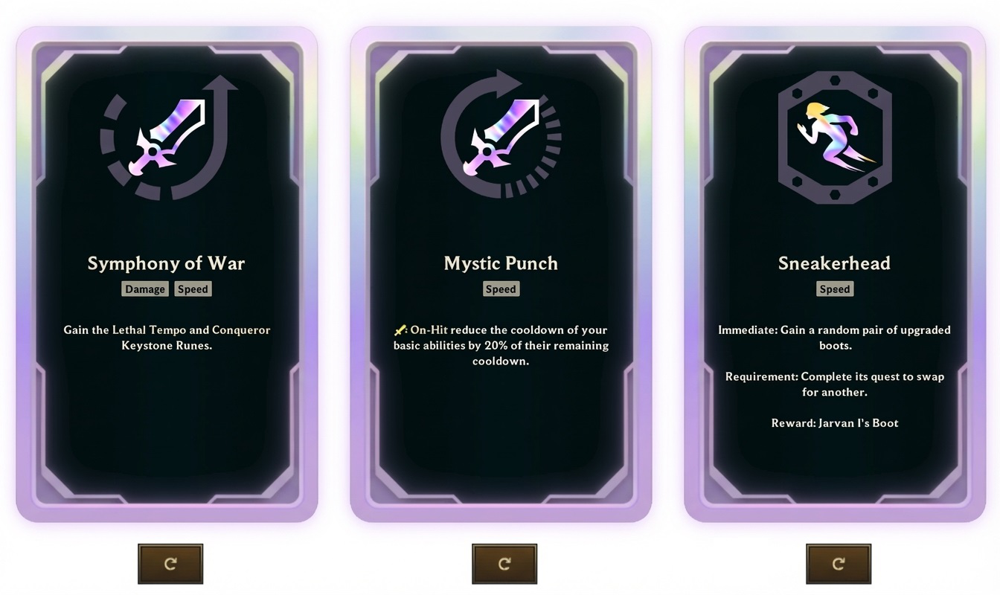

> QOJ 将此版本标注为 AI 翻译，可能存在不准确之处；有疑问时请核对原文。

## 题目描述

时间限制：2.0 秒；内存限制：2048 MB。

杰斯（Jayce）正在玩一局《极地大乱斗：大混乱》（ARAM: Mayhem）。他已经进入了海克斯强化选择阶段（Augment Selection phase），正在寻找最完美的强化来带领队伍走向胜利。具体来说，他正极度渴望搜到名为《慢而稳》（Slow and Steady）的金色彩色海克斯强化。



卡牌选择的游戏界面。糟糕，看来杰斯无法在棱彩海克斯池中找到《慢而稳》……

目前，游戏界面向杰斯展示了 $k$ 张海克斯强化卡牌。虽然每张卡牌的效果各不相同，但对杰斯来说，第 $i$ 张可见卡牌的价值为 $a_i$ 分。牌库中还有由 $n$ 张其他海克斯强化卡牌组成的隐藏候选池。已知这些卡牌的价值构成了多重集 $\{b_1, b_2, \dots, b_n\}$，但它们的顺序是完全随机均匀洗牌的。

杰斯可以对这 $k$ 个卡牌槽位中的每一个至多进行一次刷新（Reroll）。具体流程如下：

-   每个卡牌槽位下方都有独立的刷新按钮（如游戏界面所示）。
-   杰斯可以选择一个尚未刷新过的槽位，弃置当前的卡牌，并从牌库顶抽取一张卡牌来替换它。
-   杰斯在决定下一步行动（是刷新另一个可用槽位，还是停止刷新）之前，会立即看到当前刷新的结果。

在整个流程结束时，杰斯将从当前屏幕上可见的 $k$ 张卡牌中选择一张。

杰斯会采取最优策略，以最大化他最终选择的卡牌的期望价值。请计算这个最大期望强度。

## 输入格式

第一行包含两个整数 $k$ 和 $n$（$1 \le k \le n \le 10^5$），分别表示可见槽位的数量和牌库中卡牌的数量。

第二行包含 $k$ 个整数 $a_1, a_2, \dots, a_k$（$-10^5 \le a_i \le 10^5$），表示初始可见卡牌的强度。

第三行包含 $n$ 个整数 $b_1, b_2, \dots, b_n$（$-10^5 \le b_i \le 10^5$），表示牌库中卡牌的强度。

## 输出格式

输出一个实数，表示卡牌的最大期望价值。

如果你的输出与标准答案的绝对误差或相对误差不超过 $10^{-4}$，则认为你的答案是正确的。具体来说，假设你的输出为 $a$，标准答案为 $b$，当且仅当 $\frac{|a-b|}{\max(1,|b|)} \le 10^{-4}$ 时，你的输出才会被接受。

## 样例

### 输入样例 1

```text
1 2
10
1 100
```

### 输出样例 1

```text
50.5
```

### 输入样例 2

```text
3 5
3 4 7
1 2 3 5 8
```

### 输出样例 2

```text
7.4
```

### 输入样例 3

```text
2 4
-1 -2
-3 -4 -5 -6
```

### 输出样例 3

```text
-1
```

### 输入样例 4

```text
5 14
1 3 5 7 9
-1 -1 0 0 2 2 4 4 6 6 8 8 10 10
```

### 输出样例 4

```text
9.505494505
```

---

来源：[QOJ 中文题面](https://qoj.ac/problem/16335/statement/zh_cn)。保留 QOJ 提供的中文内容，仅转换为 Markdown 排版；原题及图示版权归原作者所有。
