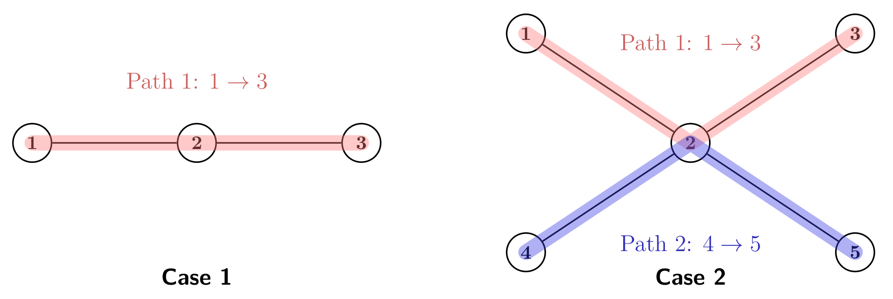

> QOJ 将此版本标注为 AI 翻译，可能存在不准确之处；有疑问时请核对原文。

## 题目描述

时间限制：3.0 秒；内存限制：2048 MB。

Piggy（在业余时间负责管理星际互联协议委员会）正面临一个棘手的硬件难题。最新的通信网格由 $n$ 个中继站通过 $(n - 1)$ 条光纤链路连接成树状结构，终于准备就绪即将部署。然而，系统的通电启动必须慎之又慎。

激活过程需要沿着特定路径发射激光脉冲。一条路径定义为两个站点之间唯一的简单路径。由于存在“量子回流干扰”（一种让委员会法务部门彻夜难眠的现象）的灾难性风险，必须严格遵守以下协议：

-   传输路径必须逐一建立。
-   为防止功率激增，每条新建立的路径与此前任意路径已激活的站点集合之间，**至多只能共享一个站点**。

形式化地，设 $S$ 为当前已激活的站点集合。对于任意由站点集合 $V(P)$ 组成的新路径 $P$，必须满足条件 $|V(P) \cap S| \le 1$。一旦一条路径成功发射脉冲，该路径上的所有站点都被视为已加入激活集合 $S$。

你的任务（如果你选择接受的话）是确定激活整个网络中每个站点所需的最少激光脉冲次数，并给出一个满足法务部门要求的路径序列。

  
前两个样例测试数据的示意图。注意在情况 2 中，第二次脉冲与第一次仅共享站点 $2$，满足无干扰规则。

## 输入格式

输入包含多组测试数据。输入的第一行包含一个整数 $T$（$1 \le T \le 10^4$），表示测试数据的组数。对于每组测试数据：

第一行包含一个整数 $n$（$2 \le n \le 3 \times 10^5$），表示网格中的站点数量。

接下来 $(n - 1)$ 行，第 $i$ 行包含两个整数 $u_i$ 和 $v_i$（$1 \le u_i, v_i \le n, u_i \neq v_i$），描述站点 $u_i$ 与站点 $v_i$ 之间的一条双向光纤链路。

保证所有链路构成一棵树，且所有测试数据中 $n$ 的总和不超过 $3 \times 10^5$。

## 输出格式

对于每组测试数据，第一行输出最少路径数 $k$。随后输出 $k$ 行，每行包含两个整数 $a_i$ 和 $b_i$，表示序列中第 $i$ 条路径的两个端点。注意，如果路径仅包含单个站点，则 $a_i$ 可以等于 $b_i$。

如果存在多种最优序列，输出任意一种严格遵守无干扰协议的方案均可。

## 样例

### 输入

```text
3
3
1 2
2 3
5
1 2
2 3
2 4
2 5
7
1 2
1 3
2 4
2 5
3 6
3 7
```

### 输出

```text
1
1 3
2
4 5
1 3
3
7 7
1 6
4 5
```

---

来源：[QOJ 中文题面](https://qoj.ac/problem/16337/statement/zh_cn)。保留 QOJ 提供的中文内容，仅转换为 Markdown 排版；原题及图示版权归原作者所有。
