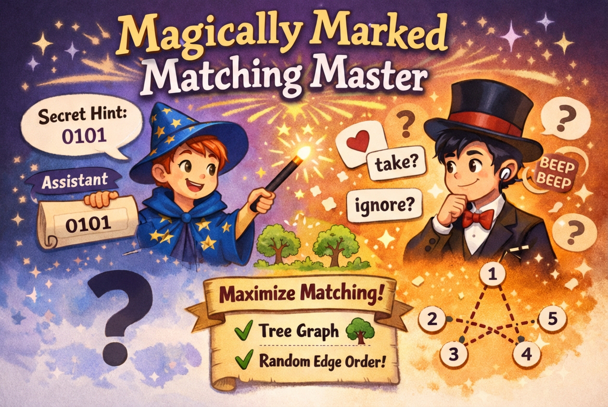

## 题目描述

时间限制：2.0 秒；内存限制：2048 MB。

这是一个多轮交互问题。请记住在每次打印后刷新输出缓冲区。要刷新输出，可以使用：

-   C/C++ 中的 `fflush(stdout)` 或 `cout.flush()`；
-   Java 和 Kotlin 中的 `System.out.flush()`；
-   Python 中的 `sys.stdout.flush()`。

在经典的在线匹配博弈中，图的边会逐一揭示。每当一条边出现时，你必须立即且不可撤销地决定是否将其包含在你的匹配中。你的目标是确保没有两条被选中的边共享同一个顶点，同时最大化所选边的总数。

你是一位渴望成名的雄心勃勃的计算机科学家。众所周知，在在线设置中找到最大匹配在概率上几乎是不可能的——即使对于二分图这样最简单的图类也是如此。然而，在别人看到根本障碍的地方，你看到了荣耀的机会。今天，你声称已经破解了树的长期未决问题，并准备向世界展示你的突破性算法。

这里只有一个问题：昨天，你在证明中发现了一个漏洞，而且你仍然不知道如何修复它。由于不愿放弃聚光灯，你决定将演示变成一场魔术表演——你隐藏在后台的助手将在游戏开始前传输一条关于整个 $n$ 个顶点树的简短提示。

你最初的计划很简单：让你的助手直接发送每个边查询的答案。为此，你安装了一个秘密耳机，能够接收一个长度为 $(n - 1)$ 的二进制字符串。但观众对你的“突破”持怀疑态度。为了防止任何预先安排的欺诈，他们要求以均匀随机的顺序呈现边——这种顺序既不是你也不是你的助手可以预测或控制的。

舞台已经搭好。灯光照在你身上。现在证明你的主张——不要换台。

## 交互协议

你的程序在每个测试点上会被执行两次。在 `prepare` 轮中，你的程序将扮演助手的角色。在 `play` 轮中，你的程序将扮演魔术师（你）的角色。在任一轮中，你的程序都将被评估为一个交互过程。

## Prepare 轮

输入的第一行包含单词 `prepare`。第二行包含一个整数 $n$ ($2 \le n \le 500$)，即顶点的数量。接下来的 $(n - 1)$ 行，每行包含两个整数 $u$ 和 $v$ ($1 \le u, v \le n, u < v$)，表示树中 $u$ 和 $v$ 之间的一条无向边。

你必须输出一行，包含一个长度恰好为 $(n - 1)$ 的二进制字符串 $s$，仅由字符 `0` 和 `1` 组成。这是传输给第二轮 `play` 的字符串。如果你的输出不符合要求的格式，你将收到 Wrong Answer 判决。

## Play 轮

你的程序将在 `play` 轮中重新启动。

第一行包含单词 `play`。第二行包含整数 $n$。第三行包含你在 `prepare` 轮中打印的二进制字符串 $s$。

之后，游戏开始，共进行 $(n - 1)$ 个回合。在每一回合中，将提供一行包含两个整数 $u$ 和 $v$ ($1 \le u, v \le n, u < v$)。作为响应，你应该输出一行，包含 `take` 或 `ignore`。第一轮中的所有边都将恰好被提供一次，且边的顺序是从 $(n - 1)!$ 种可能的排列中均匀随机选择的。

当输出格式无效时，游戏将立即结束，交互器不会提供进一步的信息。

## 正确性评估

设 $M$ 为你的程序所选取的边集。如果没有任何顶点关联超过一条选取的边，且 $|M| = |M^*|$（其中 $M^*$ 是该图的最大匹配），则认为结果是可以接受的。

除了样例测试外，共有 50 个测试点。为了通过本题，你的程序必须在所有测试点（包括样例测试）上均正确。

所有洗牌操作保证在接收程序输出之前确定。每个测试点的随机性是固定的，通过固定伪随机数生成器的种子来实现。

提供了一个测试工具来帮助你开发和测试你的程序。

## 样例

### 输入 1 (Pass 1)

```text
prepare
3
1 2
1 3
```

### 输出 1 (Pass 1)

```text
00
```

### 输入 1 (Pass 2)

```text
play
3
00
1 3
```

### 输出 1 (Pass 2)

```text
take
```

### 输入 1 (Pass 2 继续)

```text
1 2
```

### 输出 1 (Pass 2 继续)

```text
ignore
```

### 说明 1

由于 $|M^*| = 1$，选取任意一条边都是可以接受的，提示可以是任意的。



Figure 1. Magically Marked Matching Master
