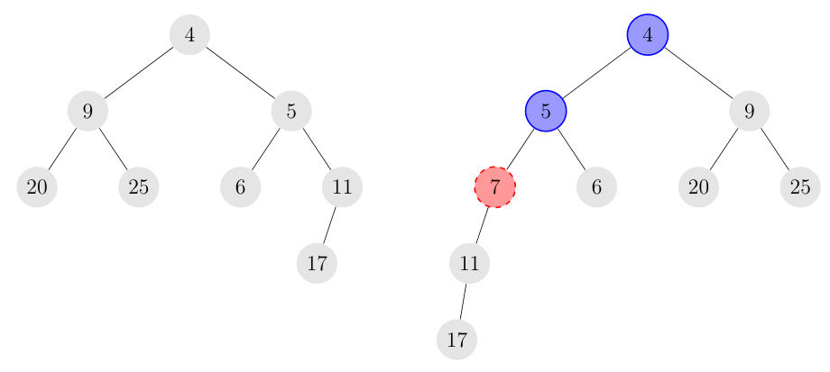

## 题目描述

时间限制：2 秒；内存限制：2048 MB。

以下内容基于真实故事——名字已被更改，因为……好吧，因为在这种故事中你总是会更改名字。

Taylor Swift 教授正在批改一份关于整数斜堆（skew heap）的家庭作业。斜堆是一棵二叉树，每个节点中存储一个整数，使得任何节点中的值都小于或等于其任何子节点中的值。请注意，斜堆不需要是完美二叉树；也就是说，任何节点的左子树和/或右子树都可能为空。

将值 $x$ 插入到斜堆 $H$ 中是通过以下递归过程完成的：

-   如果 $H$ 为空，使 $H$ 成为一个仅包含一个存储 $x$ 的节点的斜堆。
-   否则，令 $y$ 为 $H$ 根节点中的值。
    -   如果 $y < x$，交换根节点的两个子节点，并递归地将 $x$ 插入到新的左子树中。
    -   如果 $y \ge x$，创建一个值为 $x$ 的新节点，并将 $H$ 作为该节点的左子树。



图 A.1：将值 7 插入斜堆的示例。存储 4 和 5 的节点（蓝色标记）交换了它们的子节点，而存储 11 的节点成为新插入节点（红色标记）的左子节点。

现在，回到 Swift 教授。她布置的作业题要求学生展示将给定的 $1$ 到 $n$ 的数字排列按给定顺序插入空堆中后得到的堆。令人惊讶的是，一些学生的答案是错的！这让 Swift 教授产生了一个疑问：对于一个给定的堆，是否存在一个输入排列能够产生这个堆？如果存在，那么字典序最小和最大的输入排列分别是什么？

## 输入格式

输入的第一行包含一个整数 $n$ ($1 \le n \le 2 \cdot 10^5$)，表示树中节点的数量。这些节点恰好包含 $1$ 到 $n$ 的数字。接下来是 $n$ 行，其中第 $i$ 行包含两个整数 $\ell_i$ 和 $r_i$ ($i < \ell_i \le n$ 或 $\ell_i = 0$；$i < r_i \le n$ 或 $r_i = 0$)，描述存储值 $i$ 的节点的左子节点和右子节点的值，其中值 0 表示对应的子节点不存在。保证这些数据描述的是一棵二叉树。

## 输出格式

输出在斜堆插入方法下产生给定树的字典序最小的输入排列，然后输出字典序最大的输入排列。这两个排列可能会重合，在这种情况下你仍然需要将两者都输出。如果不存在能产生给定树的输入排列，则输出 `impossible`。

## 样例

### 输入格式 1

```text
7
2 3
4 5
6 7
0 0
0 0
0 0
0 0
```

### 输出格式 1

```text
1 3 2 7 5 6 4
7 1 5 3 2 6 4
```

### 输入格式 2

```text
2
0 2
0 0
```

### 输出格式 2

```text
impossible
```

### 输入格式 3

```text
3
2 0
3 0
0 0
```

### 输出格式 3

```text
2 3 1
3 2 1
```
