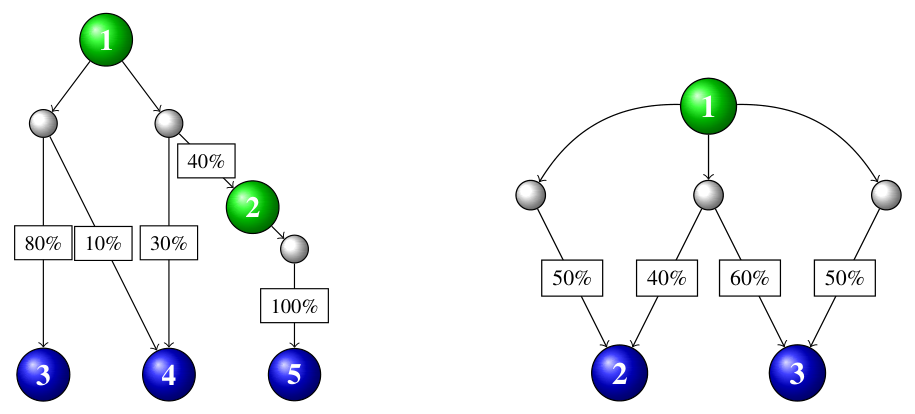

> QOJ 将此版本标注为 AI 翻译，可能存在不准确之处；有疑问时请核对原文。

## 题目描述

时间限制：12 秒；内存限制：2048 MB。

故事还在继续！几年来，你们小镇一直拥有极其丰富的 Flubber——一种可爱但略带易燃、有毒、呈酸性、有感知力且顽皮的人造化学物质。人们仍在继续寻找这种物质的更多（或者说，任何）用途。但与此同时，Flubber 工厂仍在满负荷生产。关闭工厂的努力都失败了，部分原因是没有人确切知道到底是谁在管理这家工厂。

你的任务是将源源不断流出的 Flubber 储存在各种 Flubber 蓄水池中以备后用（或者至少，让它别再给所有人添乱——字面意思上）。为了实现这一目标，你可以使用一个复杂的 Flubber 管道网络，该网络连接了各种 Flubber 站和蓄水池。

每个 Flubber 站都有一条或多条从中引出的 Flubber 管道，并配有各种可以升降的闸门，以便将流入的 Flubber 按任何期望的比例排入输出管道。例如，你可以将所有的 Flubber 送入一条管道，或者将其按 25–75 的比例分配到两条管道中，等等。

相比之下，一条 Flubber 管道会向下流向一个或多个较低的站或蓄水池，但 Flubber 流入它们的分流比例是固定的，你无法控制。部分 Flubber 也可能会流失到环境中，但那是你继任者的事，而不是你的。

你希望尽可能快地填满所有蓄水池。也就是说，在所有可能的站排水配置中，你想最大化流入任意蓄水池的 Flubber 的最小比例。

图 C.1 展示了两个样例输入。站和蓄水池显示为带编号的节点，绿色代表站，蓝色代表蓄水池。管道描绘为白色节点。例如，在第一个样例输入（左）中，Flubber 可以从站 1 按任意比例送入其两条下游管道，但每条管道都会根据其出边上印有的百分比来分配其流入量。



图 C.1：两个样例输入的示意图。

## 输入格式

第一行输入包含三个整数 $s$、$r$ 和 $d$，其中 $s$ ($1 \le s \le 10\,000$) 是站的数量，$r$ ($1 \le r \le 3$) 是蓄水池的数量，$d$ ($s \le d \le 20\,000$) 是管道的数量。站的编号为 $1$ 到 $s$，蓄水池的编号为 $s + 1$ 到 $s + r$，按海拔高度递减的顺序排列。工厂的 Flubber 最初流入站 $1$。

接下来的 $d$ 行中，每行首先包含两个整数 $i$ 和 $n$，其中 $i$ ($1 \le i \le s$) 是可以排入该管道的站，$n$ ($1 \le n \le 10$) 是该管道的输出端数量。该行的其余部分包含 $n$ 对整数 $o$ 和 $p$，其中 $o$ ($i < o \le s + r$) 是该管道排入的站或蓄水池，$p$ ($1 \le p \le 100$) 是进入该管道的 Flubber 排入 $o$ 的百分比。对于给定的管道，其 $o$ 值是互不相同的。每个站都至少有一条它可以排入的管道。给定管道的各输出端百分比之和最多为 $100$。

## 输出格式

输出一个百分比 $f$，表示最高可能的百分比，使得在某种站排水配置下，所有蓄水池接收到的 Flubber 至少占工厂生产总量的 $f\%$。你的答案与标准答案的绝对误差应不超过 $10^{-6}$。

## 样例

### 输入样例 1

```text
2 3 3
1 2 3 80 4 10
1 2 2 40 4 30
2 1 5 100
```

### 输出样例 1

```text
24.0
```

### 输入样例 2

```text
1 2 3
1 1 2 50
1 1 3 50
1 2 2 40 3 60
```

### 输出样例 2

```text
42.8571428571
```
