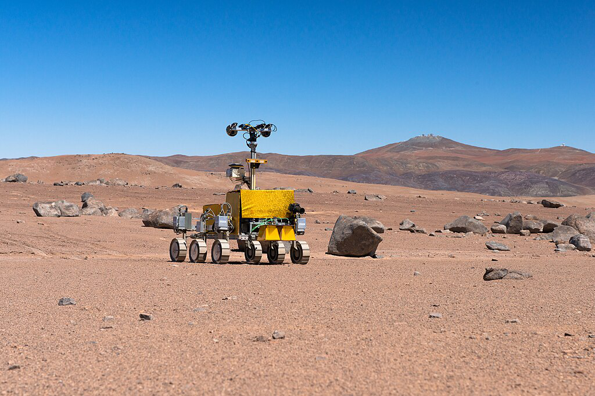

> QOJ 将此版本标注为 AI 翻译，可能存在不准确之处；有疑问时请核对原文。

## 题目描述

时间限制：2 秒；内存限制：2048 MB。



在帕瑞纳天文台附近测试的火星漫游车。CC BY-SA 4.0，由 ESO/G. Hudepohl 上传至维基共享资源。

国际行星测绘中心（ICPC）使用漫游车来探索其他行星的表面。众所周知，其他行星都是平坦的表面，可以完美且均匀地离散化为矩形网格结构。该网格中的每个单元格要么是平坦的（可以被漫游车探索），要么是多岩石的（无法通过）。

今天标志着他们全新的大黄蜂（Hornet）漫游车的发射。该漫游车被设定为使用一种简单的算法来探索行星。在内部，漫游车维护着一个**方向顺序**（direction ordering），即北（north）、东（east）、南（south）和西（west）四个方向的一个排列。当漫游车进行移动时，它会依次检查其方向顺序，选择第一个不会使其移出行星表面或移动到不可逾越的岩石上的方向，并在该方向上移动一步。

在两次连续的移动之间，漫游车可能会受到宇宙射线的袭击，从而将其方向顺序替换为另一个不同的顺序。ICPC 的科学家们记录了漫游车的移动日志，但很难人工确定漫游车的方向顺序是否以及何时发生了改变。给定漫游车所做出的移动序列，它最少可能受到了多少次宇宙射线的袭击？

## 输入格式

输入的第一行包含两个整数 $r$ 和 $c$，其中 $r$ ($1 \le r \le 200$) 是行星上的行数，$c$ ($1 \le c \le 200$) 是列数。行从北向南排列，列从西向东排列。

接下来的 $r$ 行，每行包含 $c$ 个字符，表示行星的布局。每个字符要么是 `#`（表示多岩石的区域），要么是 `.`（表示平坦的区域），要么是 `S`（表示平坦的区域，且标记了漫游车的起始位置）。网格中恰好有一个 `S`。

接下来的一行包含一个字符串 $s$，其中 $s$ 的每个字符为 `N`、`E`、`S` 或 `W`，表示漫游车执行的移动序列。字符串 $s$ 包含 $1$ 到 $10\,000$ 个字符（含边界）。所有移动都会到达平坦的区域。

## 输出格式

输出漫游车的方向顺序最少需要改变多少次，才能与其所做出的移动相一致。

## 样例

### 输入样例 1

```text
5 3
#..
...
...
...
.S.
NNEN
```

### 输出样例 1

```text
1
```

### 样例 1 说明

漫游车的方向顺序可能如下。在第一次移动中，它要么倾向于向北移动，要么倾向于先向南再向北移动。注意在后一种情况下，它无法向南移动，因为这会使它跌落行星表面。在第二次移动中，它必须倾向于向北移动。在第三次移动中，它必须倾向于向东移动。在第四次移动中，它要么倾向于向北移动，要么倾向于先向东再向北移动。因此，它可能在第二次和第三次移动之间恰好受到了一次宇宙射线的袭击，将其方向顺序从 `N???` 改变为 `EN??`，其中 `?` 代表其余任意方向。

### 输入样例 2

```text
3 5
.###.
....#
.S...
NEESNS
```

### 输出样例 2

```text
0
```

### 样例 2 说明

漫游车可能一开始的方向顺序就是 `NESW`，这与它所做出的所有移动都是一致的。

### 输入样例 3

```text
3 3
...
...
S#.
NEESNNWWSENESS
```

### 输出样例 3

```text
4
```
