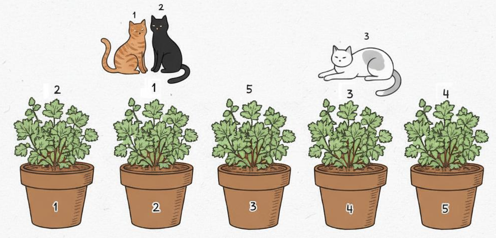

> QOJ 将此版本标注为 AI 翻译，可能存在不准确之处；有疑问时请核对原文。

## 题目描述

时间限制：2 秒；内存限制：2048 MB。

你正在巴库开一家猫咪咖啡馆，并希望为所有坐在前窗的猫咪拍一张宣传照。不幸的是，让猫咪听从你的指挥是一个众所周知的难题。但你有一个计划：你购买了 $m$ 盆猫薄荷植物，每盆都是不同的品种，并且你知道每只猫喜欢其中的哪些品种。窗前有一排共 $m$ 个花盆，按顺序编号为 $1$ 到 $m$，你将在每个花盆中放入一盆植物。然后，每只猫都会被引导（通过系在绳子上的玩具）沿着这排花盆从 $1$ 走到 $m$。一旦猫到达一个放有它喜欢的猫薄荷植物的花盆，它就会停在那里，即使那个植物旁已经有其他猫了。



图 F.1：第一个样例测试数据的一种可能的植物排列方式。

你知道你希望每只猫停在哪个花盆旁。你能否找到一种在花盆中放置植物的方法来实现这一目标？

## 输入格式

输入的第一行包含一个整数 $t$ ($1 \le t \le 10\,000$)，表示测试数据的组数。接下来是 $t$ 组测试数据的描述。

每组测试数据的第一行包含两个整数 $n$ 和 $m$，其中 $n$ ($1 \le n \le 2 \cdot 10^5$) 是猫的数量，$m$ ($1 \le m \le 2 \cdot 10^5$) 是猫薄荷植物的数量（也是花盆的数量）。猫薄荷植物的编号为 $1$ 到 $m$。

接下来的 $n$ 行每行描述一只猫。该行以两个整数 $p$ 和 $k$ 开始，其中 $p$ ($1 \le p \le m$) 是该猫应该停下的花盆编号，$k$ ($1 \le k \le m$) 是该猫喜欢的猫薄荷植物数量。该行的其余部分包含 $k$ 个互不相同的整数，表示该猫喜欢的植物编号。

在所有测试数据中，$n$ 的总和不超过 $2 \cdot 10^5$，$m$ 的总和不超过 $2 \cdot 10^5$，所有 $k$ 的总和不超过 $5 \cdot 10^5$。

## 输出格式

对于每组测试数据，如果可以按照上述要求排列猫薄荷植物，则输出 `yes`，否则输出 `no`。

## 样例

### 输入样例 1

```text
2
3 5
2 2 1 5
2 3 1 4 5
4 2 3 4
3 5
2 2 1 5
2 3 1 4 5
5 2 3 4
```

### 输出样例 1

```text
yes
no
```

## 说明

**样例 1 说明**：在第一组测试数据中，一种可能的植物排列顺序为 $[2, 1, 5, 3, 4]$。这样，猫 1 将停在花盆 2，因为这是第一个放有它喜欢的植物品种的花盆。猫 2 也会停在那里。猫 3 将一直走到花盆 4，如图 F.1 所示。

---

来源：[QOJ 中文题面](https://qoj.ac/problem/14606/statement/zh_cn)。保留 QOJ 提供的中文内容，仅转换为 Markdown 排版；原题及图示版权归原作者所有。
