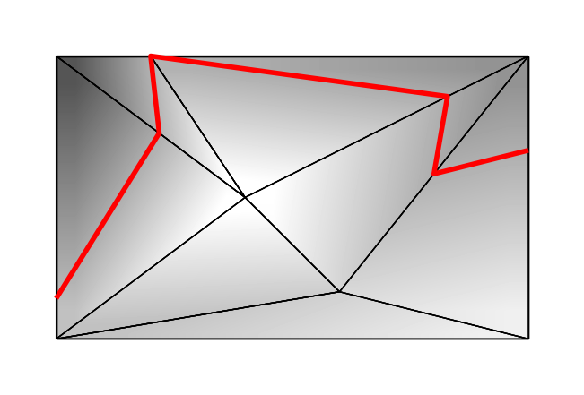

## 题目描述

时间限制：4 秒；内存限制：2048 MB。

那些讨厌的正义大军又来打扰哥布林安静祥和的土地了。建造一堵巨大的城墙效果并不好，因此哥布林们打算求助于行之有效的经典防御手段：一条填满岩浆的护城河。他们希望挖掘这条护城河，作为北方的哥布林领地与南方的伪善者领地之间的边界，自西向东横跨整个边界地区。

这给他们带来了一个挑战。边界地区即使不是崇山峻岭，也是丘陵起伏，而岩浆护城河必须处于同一高度——否则高处的岩浆会流下并从低处的护城河中溢出。因此，哥布林必须选择一条完全处于同一海拔高度的路径，并将边界地区的西侧边界与东侧边界连接起来。出于显而易见的经济原因，他们希望这条路径尽可能短。

这就是你需要解决的问题。给你一张边界地区的海拔地图，你的任务是确定护城河的最短长度。

地图的形式是一个尺寸为 $w \times \ell$ 的完全三角剖分矩形，所有三角形的面积均为正。没有任何三角形的顶点位于另一个三角形边的内部。地图的西南角坐标为 $(0, 0)$，$x$ 轴指向正东，$y$ 轴指向正北。此外，西侧边界（连接 $(0, 0)$ 和 $(0, \ell)$ 的线段，包括端点）是一条单一的边。类似地，东侧边界（连接点 $(w, 0)$ 和 $(w, \ell)$ 的线段）也是一条单一的边。

当然，这张地图只是实际三维地形的二维投影：每个点 $(x, y)$ 也有一个海拔高度 $z$。三角剖分顶点处的海拔高度由地图直接指定，且所有这些给定的海拔高度都是互不相同的。所有其他点处的海拔高度可以通过在相关三角形上进行线性插值来计算。换句话说，地形的形状就像是一组通过公共边连接在一起的三角形面。这些面与地图上的三角形相对应。



图 G.1：样例测试用例的示意图。阴影表示海拔高度，红色粗线表示最优护城河。

## 输入格式

第一行输入包含一个整数 $t$ ($1 \le t \le 10\,000$)，表示测试用例的数量。接下来是 $t$ 个测试用例的描述。

每个测试用例的第一行包含四个整数 $w$、$\ell$、$n$ 和 $m$，其中 $w$ ($1 \le w \le 10^6$) 是边界地区自西向东的范围，$\ell$ ($1 \le \ell \le 10^6$) 是自南向北的范围，$n$ ($4 \le n \le 50\,000$) 是顶点的数量，$m$ ($n - 2 \le m \le 2n - 6$) 是提供的三角剖分中三角形的数量。

紧接着是 $n$ 行，其中第 $i$ 行包含三个整数 $x_i$、$y_i$ 和 $z_i$ ($0 \le x_i \le w$；$0 \le y_i \le \ell$；$0 \le z_i \le 10^6$)，表示顶点 $i$ 的坐标和海拔高度。仅有的满足 $x_i = 0$ 或 $x_i = w$ 的顶点是矩形的四个角。所有点对 $(x_i, y_i)$ 互不相同。所有 $z_i$ 互不相同。

接下来的 $m$ 行中，每行包含三个不同的整数 $a$、$b$ 和 $c$ ($1 \le a, b, c \le n$)，表示由顶点 $a$、$b$ 和 $c$ 按逆时针顺序构成的地图三角形。这些三角形构成了矩形 $[0, w] \times [0, \ell]$ 的一个完整三角剖分。这 $n$ 个顶点中的每一个都至少被一个三角形引用。

在所有测试用例中，$n$ 的总和最多为 $50\,000$。

## 输出格式

对于每个测试用例，如果可以在单一海拔高度上建造一条连接西侧边界和东侧边界的岩浆护城河，则输出该护城河的最短长度，绝对误差或相对误差不超过 $10^{-6}$。否则，输出 `impossible`。

## 样例

### 输入样例 1

```text
3
6 6 4 2
0 0 1
6 0 4
6 6 3
0 6 2
1 2 3
1 3 4
6 6 4 2
0 0 1
6 0 2
6 6 4
0 6 3
1 2 3
1 3 4
10 6 7 7
6 1 8
10 0 10
10 6 4
2 6 6
0 6 0
4 3 11
0 0 7
2 1 7
2 3 1
3 6 1
3 4 6
6 4 5
5 7 6
7 1 6
```

### 输出样例 1

```text
impossible
6.708203932
15.849260054
```
