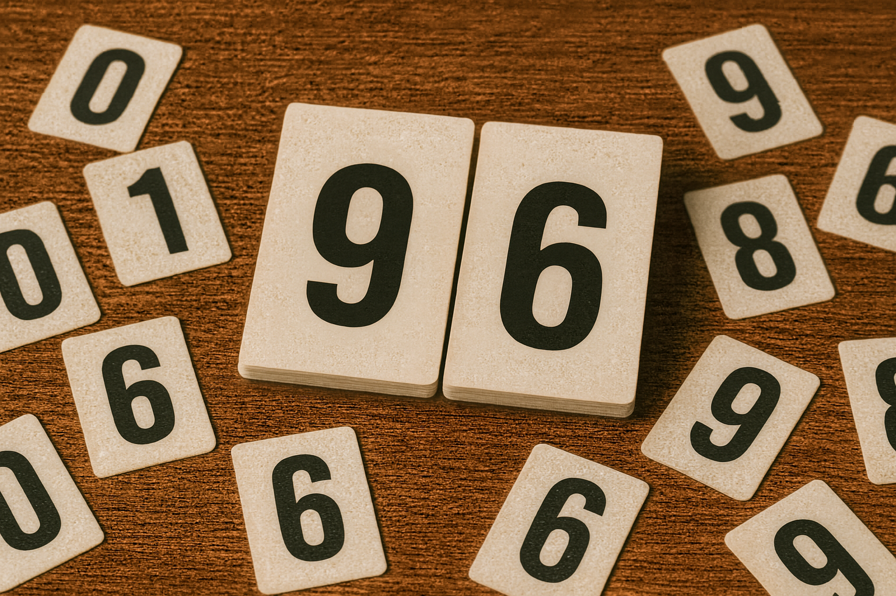

> QOJ 将此版本标注为 AI 翻译，可能存在不准确之处；有疑问时请核对原文。

## 题目描述

时间限制：2 秒；内存限制：2048 MB。



自从你来到大学，你就一直不遗余力地向学校（以及全世界）推广一项全新的、结合了武术与卡牌的运动——“接触桥牌”（Contact Bridge）。终于，在你（极其执着且令人厌烦的）游说下，你从院长那里获得了许可和资金，来为这项运动建造一个宏伟的新场馆！好吧，技术上来说，它与其说是“场馆”，不如说是一个“扫帚间”；与其说是“宏伟”，不如说是“拥挤”；而且它是否算得上“新”也有待商榷。但未来的运动总得有个起点！

不幸的是，你刚刚意识到，为了进行比赛，你需要一个比分显示牌。在接触桥牌中，队伍的初始分数为 $0$。在进行各种可重复的动作后，分数会增加特定的固定分值。此外，还有一个最大分值限制——如果队伍的分数在增加后会超过最大值，它将被限制（封顶）在最大值。你希望队伍的分数在任何时候都是可见的，因此你需要准备一些印有单个数字的标牌，通过组合它们来显示分数。

不幸的是，院长的“资金”快用完了，而这些标牌非常昂贵。请计算出你需要购买的最少标牌集合，以便能够显示在游戏过程中可能达到的任何分数。注意，你不需要任何数字 $9$ 的标牌，因为任何数字 $6$ 的标牌都可以倒过来当作 $9$ 使用。

## 输入格式

输入的第一行包含两个整数 $m$ 和 $n$，其中 $m$ ($1 \le m \le 10^{18}$) 是最大分值，$n$ ($1 \le n \le 10$) 是不同的得分方式数量。

接下来的 $n$ 行，每行包含一个整数 $p$ ($1 \le p \le 1\,000$)，表示游戏中某种动作所奖励的分数。没有两种动作会奖励相同的分数。

## 输出格式

按数字 $0$ 到 $8$ 的升序，每行输出两个整数：数字本身，以及你需要购买的该数字标牌的数量。如果某个数字需要的标牌数量为 $0$，则省略该数字的输出。

## 样例

### 输入样例 1

```text
1000 4
60
100
222
650
```

### 输出样例 1

```text
0 3
1 1
2 3
3 1
4 3
5 1
6 3
7 2
8 3
```

### 输入样例 2

```text
967 1
1000
```

### 输出样例 2

```text
0 1
6 2
7 1
```

---

来源：[QOJ 中文题面](https://qoj.ac/problem/14608/statement/zh_cn)。保留 QOJ 提供的中文内容，仅转换为 Markdown 排版；原题及图示版权归原作者所有。
