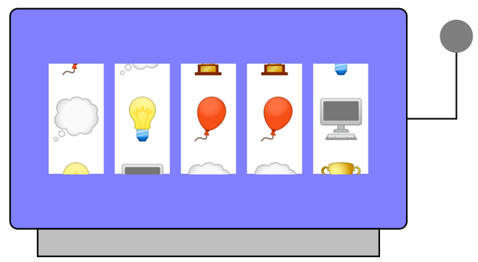

> QOJ 将此版本标注为 AI 翻译，可能存在不准确之处；有疑问时请核对原文。

## 题目描述

时间限制：2 秒；内存限制：2048 MB。

Imperial Chance & Play 赌场提供一种使用老虎机进行的游戏。该老虎机有 $n$ 个并排排列的轮盘。每个轮盘上都有 $n$ 个不同的符号，且这些符号在每个轮盘上出现的顺序相同。每个轮盘通过机器前方的窗口显示其上的一个符号，从而在前方呈现出一个由 $n$ 个符号组成的并排序列。



图 I.1：样例交互 1 中的初始配置。

你正站在机器后面，注意到一个维护面板被打开了。当你把手伸进去时，你可以秘密地将任意轮盘旋转任意步数，从而改变该轮盘上显示的符号。你想赢得大奖，这需要所有轮盘在同一时间显示相同的符号。不幸的是，从你的位置无法看到这些符号，所以你请求你的好朋友来帮忙。你的朋友站在机器前，她会告诉你她当前看到的序列中不同符号的数量。如果你的朋友在你每次操作后都更新这一信息，你能通过操作轮盘来赢得大奖吗？

## 交互

输入的第一行包含一个整数 $n$ ($3 \le n \le 50$)，表示机器中轮盘的数量和符号的数量。

随后交互按轮进行。在每一轮中，你将获得一行输入，其中包含一个整数 $k$ ($1 \le k \le n$)，表示当前序列中不同符号的数量。

如果 $k > 1$，输出两个整数 $i$ 和 $j$ ($1 \le i \le n$；$-10^9 \le j \le 10^9$)，代表你的操作：将第 $i$ 个轮盘旋转 $j$ 个位置，其中负数表示向相反方向旋转。

否则，如果 $k = 1$，表示所有轮盘都显示相同的符号，你的程序必须退出，且不能再输出任何内容。

你最多允许进行 $10\,000$ 次操作——如果你的提交使用了更多的轮数，它将不被接受。保证轮盘的初始配置不会已经是所有轮盘都显示相同符号的状态（即第一轮中 $k > 1$）。

评测程序不会采取对抗性策略，这意味着初始配置在第一次操作之前就已经固定。

本题提供了一个测试工具，以帮助你开发和测试你的解决方案。

## 样例

### 输入样例 1

```text
5
4
3
3
3
2
1
```

### 输出样例 1

```text
1 1
4 2
3 1
3 1
5 4
```

### 输入样例 2

```text
3
3
2
2
1
```

### 输出样例 2

```text
2 -1
3 -1
2 -1
```

---

来源：[QOJ 中文题面](https://qoj.ac/problem/14609/statement/zh_cn)。保留 QOJ 提供的中文内容，仅转换为 Markdown 排版；原题及图示版权归原作者所有。 QOJ 中文页中失效或错配的图片已按原有顺序补为[官方英文题面](https://qoj.ac/download.php?type=attachments&id=2522&r=0)中的对应图示。
