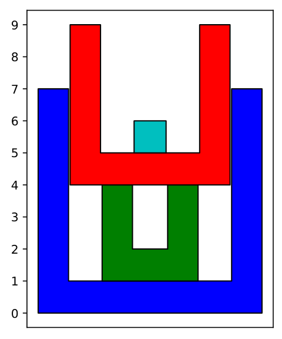

> QOJ 将此版本标注为 AI 翻译，可能存在不准确之处；有疑问时请核对原文。

## 题目描述

时间限制：2 秒；内存限制：2048 MB。

你有一组 $n$ 个圆柱形杯子，其中第 $i$ 个杯子的高度为 $2i - 1$ 厘米。杯子的直径依次递增，使得杯子 $i$ 能够放入杯子 $j$ 中当且仅当 $i < j$。每个杯子的底部厚度均为 $1$ 厘米（这使得最小的杯子相当没用，因为它只有 $1$ 厘米高，但出于情感原因你还是保留了它）。

洗完所有的杯子后，你将它们叠成一个塔。每个杯子都朝上放置（换句话说，开口朝上），并且所有杯子的中心在垂直方向上对齐。塔的高度定义为所有杯子中最低点到最高点之间的垂直距离。你想知道应该以什么顺序放置这些杯子，使得最终的高度（以厘米为单位）恰好是你最喜欢的数字。注意，必须使用所有 $n$ 个杯子。

例如，假设 $n = 4$ 且你最喜欢的数字是 $9$。如果你按照高度为 $7, 3, 5, 1$ 的顺序依次放置杯子，那么塔的总高度将为 $9$，如图 J.1 所示。



图 J.1：样例输出 1 的示意图。

## 输入格式

输入仅包含一行，其中有两个整数 $n$ 和 $h$，其中 $n$ ($1 \le n \le 2 \cdot 10^5$) 表示杯子的数量，$h$ ($1 \le h \le 4 \cdot 10^{10}$) 是你最喜欢的数字。

## 输出格式

如果可以建造一个高度为 $h$ 的塔，则按照放置顺序输出所有杯子的高度。否则，输出 `impossible`。如果存在多种合法的杯子顺序，接受其中任意一种。

## 样例

### 输入样例 1

```text
4 9
```

### 输出样例 1

```text
7 3 5 1
```

### 输入样例 2

```text
4 100
```

### 输出样例 2

```text
impossible
```
