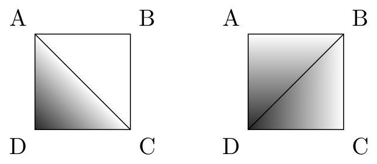

## 题目描述

时间限制：4 秒；内存限制：2048 MB。

经过多年的搜寻，你终于找到了黑胡子船长那张标有他失落已久的宝藏埋藏地点的古老地图，它就深藏在海底。这张地图曾经是一幅分层设色图——也就是说，它展示了宝藏周围区域的海洋深度——但随着时间的推移，许多海拔标记已经褪色，不再清晰可辨。

具体来说，这张地图覆盖了海洋的一个矩形区域，该区域被细分为一个 $(n - 1) \times (m - 1)$ 的单位正方形网格。地图最初显示了每个具有整数坐标 $1 \le x \le n$ 且 $1 \le y \le m$ 的点 $p = (x, y)$ 的海洋深度 $d(p)$。该区域内没有岛屿。换句话说，已知对于所有点，都有 $d(p) \ge 0$。

绘制这张地图对黑胡子来说一定是一件相当困难的事，因为对于非整数坐标的点的深度，并没有唯一且自然的插值方法。考虑网格上的一个单位正方形，其顶点按顺时针顺序依次为 $A, B, C, D$，并且每个点 $p \in \{A, B, C, D\}$ 都存储了某个深度 $d(p)$。一种自然的方法是在三角形 $ABC$ 内进行线性插值，同样在 $CDA$ 内也进行线性插值。另一种同样自然的方法是在 $BCD$ 内进行线性插值，同样在 $DAB$ 内也进行线性插值。通常，这两种插值的结果是不同的。例如，如果 $d(A) = d(B) = d(C) = 0$ 且 $d(D) = 1$，第一种方法会导致整个 $ABC$ 区域内的深度都等于零（图 K.1 左），而第二种方法会导致整个正方形内部的深度均为正数（右）。



图 K.1：在一个单位正方形内进行深度插值的两种方法。

然而，黑胡子既残忍又固执，他不会让这种令人讨厌的歧义阻止他。为了给他的宝藏找到完美的藏匿地点，他搜寻了七大洋，以找到一个在每个单位正方形上上述两种方法都能产生相同结果的海洋区域（或者也许他强迫他的一些海盗进行了一些地形改造工作来实现这一点——学者们对此意见不一）。

回到现在，你正在准备一次寻找宝藏的探险，并希望弄清楚宝藏可能埋藏在多深的地方。具体来说，给定地图上剩余的深度数据，你应该计算出宝藏所在位置的最小可能深度。

## 输入格式

输入的第一行包含五个整数 $n, m, k, t_x$ 和 $t_y$，其中 $n$ 和 $m$（$2 \le n, m \le 3 \cdot 10^5$）表示网格的最大坐标，$k$（$1 \le k \le 3 \cdot 10^5$）是已知深度的数量，而 $(t_x, t_y)$ 是宝藏的位置（$1 \le t_x \le n$；$1 \le t_y \le m$）。

接下来的 $k$ 行，每行包含三个整数 $x, y$ 和 $d$（$1 \le x \le n$；$1 \le y \le m$；$0 \le d \le 10^9$），表示网格坐标 $(x, y)$ 处的深度等于 $d$。每个点对 $(x, y)$ 在输入中最多出现一次。

## 输出格式

如果给定的数据点可以扩展为一张有效的地图（即，对于每个单位正方形，两种插值方法产生相同的结果，且所有点的深度均为非负数），则输出一个整数：$(t_x, t_y)$ 处的最小可能深度——可以证明这总是一个整数。否则，输出 `impossible`。

## 样例

### 输入样例 1

```text
3 3 5 1 1
1 3 1
3 3 2
2 3 3
2 2 4
2 1 5
```

### 输出样例 1

```text
3
```

### 输入样例 2

```text
3 5 4 3 4
2 4 1
2 2 2
1 1 4
3 1 5
```

### 输出样例 2

```text
1
```

### 输入样例 3

```text
3 3 3 3 3
2 3 1
2 1 2
1 2 4
```

### 输出样例 3

```text
0
```

### 输入样例 4

```text
3 3 4 3 2
2 1 2
2 3 3
1 3 4
1 1 5
```

### 输出样例 4

```text
impossible
```

### 输入样例 5

```text
3 3 3 2 2
3 2 0
2 2 1
2 3 0
```

### 输出样例 5

```text
impossible
```

### 说明

**样例 5 说明**：尽管输入中给出了 $(2, 2)$ 的深度，但提供的数据点无法扩展为一张有效的地图，因此正确答案为 `impossible`。
