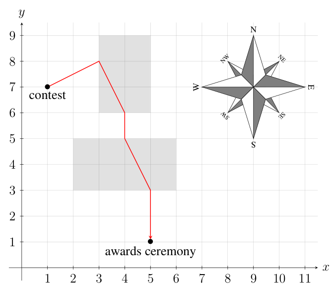

## 题目描述

时间限制：2 秒；内存限制：2048 MB。

我正漫步在阳光下，但这感觉并不好——我的眼睛好痛！

巴库阳光充足。如果你背对太阳行走，或者至少垂直于太阳光线行走，阳光就不会直射你的眼睛。在本题中，假设太阳从南方照来。向西、向东或在西和东之间且带有向北分量的任何方向行走，都可以避免直视太阳。如果你向任何带有向南分量的方向行走，你的眼睛就会感到刺痛。

巴库也有许多矩形的阴影区域，待在这些区域内可以保护你的眼睛，无论你朝哪个方向行走。例如，图 L.1 展示了两个阴影区域。

请计算从比赛地点到颁奖典礼地点，你必须在阳光直射眼睛的情况下行走的最小距离。



图 L.1：样例输入 1 以及一条使阳光直射眼睛的距离最小化的路径。

## 输入格式

输入的第一行包含五个整数 $n$、$x_c$、$y_c$、$x_a$ 和 $y_a$，其中 $n$ ($0 \le n \le 10^5$) 是阴影区域的数量，($x_c, y_c$) 是比赛地点，($x_a, y_a$) 是颁奖典礼地点 ($-10^6 \le x_c, y_c, x_a, y_a \le 10^6$)。太阳沿方向 $(0, 1)$ 从南向北照射。如果你在任何 $y < 0$ 且任意 $x$ 的方向 $(x, y)$ 上行走，你就会直视太阳。

接下来的 $n$ 行描述阴影区域，它们是与坐标轴平行的矩形。这些行中的每一行都包含四个整数 $x_1$、$y_1$、$x_2$ 和 $y_2$ ($-10^6 \le x_1 < x_2 \le 10^6$；$-10^6 \le y_1 < y_2 \le 10^6$)。矩形的西南角为 $(x_1, y_1)$，东北角为 $(x_2, y_2)$。描述阴影区域的矩形互不接触且互不相交。

## 输出格式

输出你必须在阳光直射眼睛的情况下行走的最小距离。你的答案与标准答案的绝对误差或相对误差不能超过 $10^{-7}$。

## 样例

### 输入样例 1

```text
2 1 7 5 1
3 6 5 9
2 3 6 5
```

### 输出样例 1

```text
3.0
```

### 说明 1

样例 1 说明：图 L.1 展示了一条从比赛地点到颁奖典礼地点的最优路径，共包含 5 个线段。在第一段上，你背对太阳行走。在第二段和第四段上，你朝太阳方向行走，但处于阴影区域内。在第三段和第五段上，你在阴影区域外朝太阳方向行走。这两段的总长度为 3。

### 输入样例 2

```text
2 0 10 10 0
2 7 3 8
4 3 8 5
```

### 输出样例 2

```text
7.0
```

### 输入样例 3

```text
2 11 -1 -1 11
2 7 3 8
4 3 8 5
```

### 输出样例 3

```text
0.0
```

### 输入样例 4

```text
3 1 5 9 5
-5 6 2 9
4 7 12 8
1 1 7 3
```

### 输出样例 4

```text
0.0
```

### 输入样例 5

```text
3 1 7 9 3
2 6 3 8
4 4 5 6
6 2 7 4
```

### 输出样例 5

```text
0.0
```

### 输入样例 6

```text
1 0 0 0 0
-5 -5 5 5
```

### 输出样例 6

```text
0.0
```
