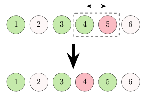

> QOJ 将此版本标注为 AI 翻译，可能存在不准确之处；有疑问时请核对原文。

## 题目描述

时间限制：1.0 秒；内存限制：512 MB。

小青鱼喜欢吃三色团子！


图 1：小青鱼

现在有 $n$ 个团子排成一排，每个团子的颜色为青色 (`C`)、白色 (`W`) 或粉色 (`P`) 之一。团子从 $1$ 到 $n$ 编号。

小青鱼认为一个团子序列是**美丽的**，当且仅当任意两个相邻的团子颜色都不同。

为了让这个三色团子序列变得更加美丽，小青鱼决定选择一个区间 $[l,r]$ ($1\le l\le r\le n$)，并任意重新排列该区间内的所有团子，使得重新排列后整个团子序列变得美丽。

小青鱼希望选择的区间尽可能短。你能帮帮他吗？你需要输出最优的区间，以及重新排列后的整个序列。

注意，原始序列可能已经非常美丽，或者可能无论如何重新排列都无法变得美丽。

## 输入格式

输入包含多组测试数据。第一行包含一个整数 $t$ ($1\le t\le10^5$)，表示测试数据的组数。对于每组测试数据：

-   第一行包含一个整数 $n$ ($1\le n\le2\cdot10^6$)，表示团子序列的长度。
    
-   第二行包含一个长度为 $n$ 的字符串，其中第 $i$ 个字符表示第 $i$ 个团子的颜色，其中 `C` 代表青色，`W` 代表白色，`P` 代表粉色。
    

保证所有测试数据的 $n$ 之和不超过 $2\cdot10^6$。

## 输出格式

对于每组测试数据：

-   如果团子序列已经非常美丽，输出单行 `Beautiful`。
    
-   否则，如果无论如何重新排列都无法使团子序列变得美丽，输出单行 `Impossible`。
    
-   否则，输出三行：
    
    -   第一行包含单词 `Possible`。
    -   第二行包含两个整数 $l$ 和 $r$，表示选择的区间 ($1\le l\le r\le n$)。
    -   第三行包含一个长度为 $n$ 的字符串，表示重新排列后所有团子的颜色。

如果存在多个可能的解，你可以输出其中任意一个。

## 样例

### 输入样例 1

```text
4
5
CWCWC
6
CWCCPW
3
PPP
8
CWPPCWWC
```

### 输出样例 1

```text
Beautiful
Possible
4 5
CWCPCW
Impossible
Possible
4 6
CWPWCPWC
```

### 说明

在第一组测试数据中，团子序列已经非常美丽。


在第二组测试数据中，初始时团子序列不美丽，因为第三个和第四个相邻的团子都是青色。但小青鱼可以通过选择区间 $[4,5]$ 并交换其中的两个团子来解决这个问题。



很容易证明，该解法选择的区间长度是尽可能短的。

在第三组测试数据中，小青鱼无法通过任何重新排列使其变得美丽。
