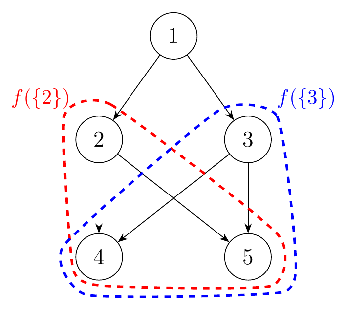

> QOJ 将此版本标注为 AI 翻译，可能存在不准确之处；有疑问时请核对原文。

## 题目描述

时间限制：1.0 秒；内存限制：512 MB。

给定两个整数 $n$ 和 $m$，你需要构造一个包含恰好 $n$ 个顶点和 $m$ 条边的有向无环图（DAG） $G = (V, E)$。

在图 $G$ 中，当且仅当存在一条从顶点 $u$ 开始并以顶点 $v$ 结束的路径时，称顶点 $v$ 是从顶点 $u$ **可达**的。

对于非空顶点集 $A \subseteq V$，当且仅当顶点 $w$ 从 $A$ 中的每个顶点都是可达的时，定义顶点 $w$ 对于 $A$ 是**优秀的**（good）。我们用 $f(A)$ 表示对于 $A$ 的所有优秀顶点的集合。

你构造的图应该同时满足以下两个约束条件：

-   对于每个顶点 $i$（$1 \le i \le n$），它都是从顶点 $1$ 可达的。
-   存在 $k$ 个不同的非空顶点集 $S_1, S_2, \dots, S_k$，使得 $f(S_1), f(S_2), \dots, f(S_k)$ 两两不同。注意 $f(S_i)$ 可以为空集。

为了证明你构造的图 $G$ 满足第二个约束条件，你还需要提供满足该约束条件的 $k$ 个集合 $S_1, S_2, \dots, S_k$。

## 输入格式

输入唯一的一行包含三个整数 $n$，$m$ 和 $k$。

本题中只有 2 个测试点：

1.  $n = 5, m = 6, k = 6$；
2.  $n = 100, m = 128, k = 16\,000$。

## 输出格式

输出的前 $m$ 行描述你构造的图 $G$。每行包含两个整数 $u, v$，表示图中的一条从 $u$ 到 $v$ 的有向边。

接下来的 $k$ 行描述你提供的 $k$ 个顶点集。第 $i$ 行首先包含集合 $S_i$ 的大小，后跟 $|S_i|$ 个代表该集合中每个顶点的数字。

## 样例

### 输入样例 1

```text
5 6 6
```

### 输出样例 1

```text
1 2
1 3
2 4
3 5
2 5
3 4
1 1
1 2
1 3
1 4
1 5
2 2 3
```

## 说明

在样例中，输出构造了一个包含 $n = 5$ 个顶点和 $m = 6$ 条边的图。对应的 $k = 6$ 个集合为 $S_1 = \{1\}, S_2 = \{2\}, S_3 = \{3\}, S_4 = \{4\}, S_5 = \{5\}, S_6 = \{2, 3\}$。

这里，顶点 4 和 5 都可以从 $S_6 = \{2, 3\}$ 中的任意元素到达，因此 $f(\{2, 3\}) = \{4, 5\}$。连同 $f(S_1) = \{1, 2, 3, 4, 5\}$，$f(S_2) = \{2, 4, 5\}$，$f(S_3) = \{3, 4, 5\}$，$f(S_4) = \{4\}$，$f(S_5) = \{5\}$，这些集合两两不同，满足约束条件。


