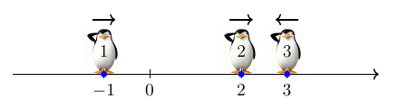
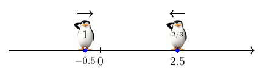

> QOJ 将此版本标注为 AI 翻译，可能存在不准确之处；有疑问时请核对原文。

## 题目描述

时间限制：3.0 秒；内存限制：512 MB。

有 $n$ 只企鹅站在数轴上。第 $i$ 只企鹅的初始坐标为 $a_i$。保证所有的 $a_i$ 两两不同。

每只企鹅选择一只目标企鹅，记为 $t_i$（$1 \le t_i \le n$ 且 $t_i \ne i$）。在时刻 $0$，所有企鹅同时开始移动。每只企鹅都以每秒 $0.5$ 单位长度的恒定速度向其目标企鹅的当前位置奔跑。

当企鹅 $i$ 与企鹅 $t_i$ 相遇时，它会立即停止移动。对于每只企鹅，确定它停止移动的时间。这里，企鹅 $i$ 与企鹅 $t_i$ 相遇当且仅当它们在同一时刻处于同一坐标。

可以证明，每只企鹅都会在有限时间内停止移动，且停止时间总是整数。

## 输入格式

输入的第一行包含一个整数 $n$（$2 \le n \le 5 \cdot 10^5$），表示企鹅的数量。

第二行包含 $n$ 个整数 $t_1,t_2,\ldots,t_n$（$1 \le t_i \le n$ 且 $t_i \ne i$），其中 $t_i$ 是第 $i$ 只企鹅选择的目标企鹅。

第三行包含 $n$ 个互不相同的整数 $a_1,a_2,\ldots,a_n$（$-5 \cdot 10^8 \le a_i \le 5 \cdot 10^8$），其中 $a_i$ 是第 $i$ 只企鹅的初始坐标。

## 输出格式

输出一行，包含 $n$ 个整数，其中第 $i$ 个整数表示第 $i$ 只企鹅停止移动的时间（以秒为单位）。

## 样例

### 输入样例 1

```text
3
2 3 1
-1 2 3
```

### 输出样例 1

```text
7 1 4
```

### 输入样例 2

```text
10
8 3 6 7 1 8 2 10 8 1
0 -14 5 -3 14 -12 11 8 -18 17
```

### 输出样例 2

```text
25 21 17 14 14 49 29 9 61 17
```

## 说明

在样例中，最初由于第二只企鹅在第一只企鹅的正方向，第一只企鹅向正方向奔跑。类似地，第二只企鹅向正方向奔跑，而第三只企鹅向负方向奔跑。这三只企鹅在数轴上的初始位置如下图所示：



在第 $1$ 秒时，第二只企鹅和第三只企鹅在 $x = 2.5$ 处相遇，此时第二只企鹅停止移动。



此时，第一只企鹅位于 $-0.5$，第二只企鹅位于 $2.5$。它们之间的距离为 $3$。由于第一只企鹅以每秒 $0.5$ 单位长度的速度奔跑，它还需要 $6$ 秒才能到达第二只企鹅的位置。因此，第一只企鹅在第 $7$ 秒停止移动。

在第一只企鹅停止之前，第三只企鹅在第 $4$ 秒与它相遇。因此，答案分别为 $7$、$1$ 和 $4$。

---

来源：[QOJ 中文题面](https://qoj.ac/problem/14686/statement/zh_cn)。保留 QOJ 提供的中文内容，仅转换为 Markdown 排版；原题及图示版权归原作者所有。
