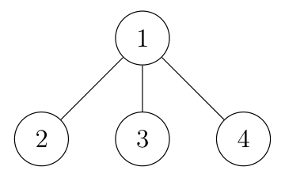

> QOJ 将此版本标注为 AI 翻译，可能存在不准确之处；有疑问时请核对原文。

## 题目描述

时间限制：1.0 秒；内存限制：512 MB。

给定一个大小为 $n \times n$ 的非负整数矩阵 $A$。对于一棵包含 $n$ 个节点（编号为 $1$ 到 $n$）的树，当且仅当满足以下条件时，我们称其为一棵 **holly 树**：

-   对于任意一对节点 $u$ 和 $v$（$1 \le u, v \le n$），$A_{u,v}$ 等于该树中从 $u$ 到 $v$ 的简单路径上所有节点编号的按位异或和。

你的任务是构造一棵 holly 树。保证这样的 holly 树总是存在。

## 输入格式

输入的第一行包含一个整数 $n$（$2 \le n \le 2000$），表示矩阵 $A$ 的大小。

接下来的 $n$ 行描述矩阵 $A$。第 $i$ 行包含 $n - i + 1$ 个整数 $A_{i,i}, A_{i,i+1}, \dots, A_{i,n}$（$0 \le A_{i,j} < 2^{11}$）。注意，对于所有 $1 \le i, j \le n$，均满足 $A_{i,j} = A_{j,i}$。

保证这样的 holly 树总是存在。

## 输出格式

输出 $n - 1$ 行，每行包含两个整数 $u$ 和 $v$（$1 \le u, v \le n$），表示 holly 树的一条边。

## 样例

### 输入 1

```text
2
1 3
2
```

### 输出 1

```text
1 2
```

### 输入 2

```text
4
1 3 2 5
2 0 7
3 6
4
```

### 输出 2

```text
1 2
1 3
1 4
```

### 输入 3

```text
6
1 7 4 5 2 3
2 1 6 7 0
3 5 4 3
4 3 2
5 5
6
```

### 输出 3

```text
4 1
2 3
6 4
5 2
4 2
```

## 说明

在第二个样例中，输出的树如下图所示：



这棵树是一棵 holly 树。例如，对于节点对 $(2, 4)$，从 $2$ 到 $4$ 的简单路径包含节点 $2$、$1$ 和 $4$，其按位异或和为 $2 \oplus 1 \oplus 4 = 7$，满足输入中给出的约束条件 $A_{2,4} = 7$。

---

来源：[QOJ 中文题面](https://qoj.ac/problem/14689/statement/zh_cn)。保留 QOJ 提供的中文内容，仅转换为 Markdown 排版；原题及图示版权归原作者所有。 QOJ 中文页中失效或错配的图片已按原有顺序补为[官方英文题面](https://qoj.ac/download.php?type=attachments&id=2562&r=0)中的对应图示。
