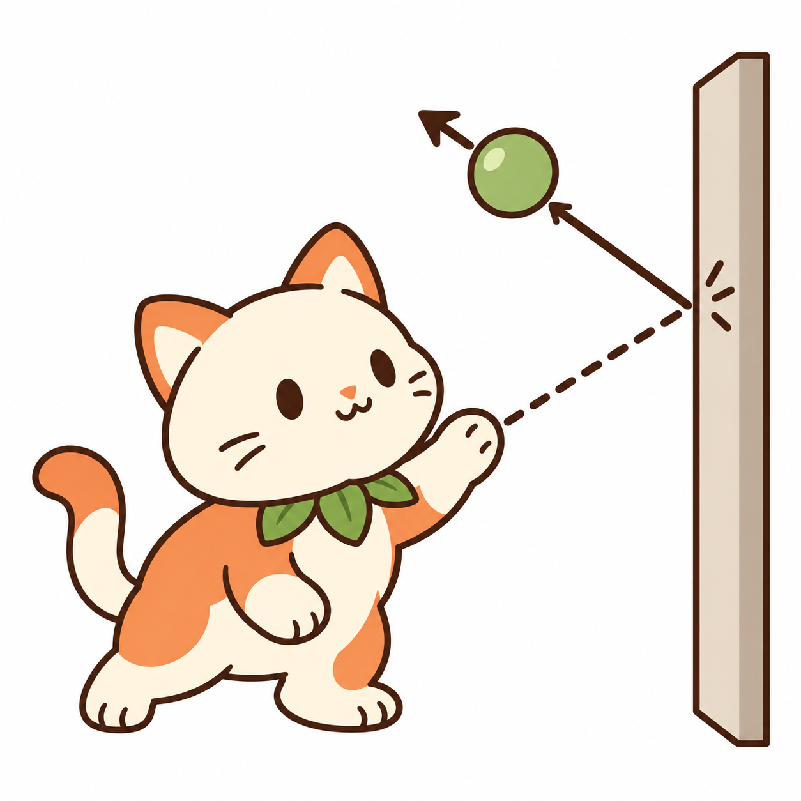
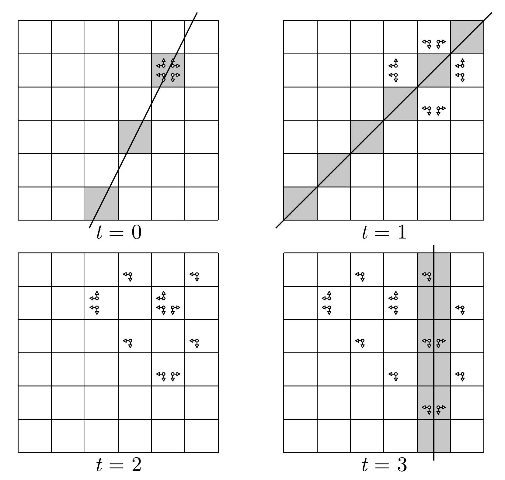

## 题目描述

时间限制：2 秒；内存限制：1024 MB。

**本题包含附件。你可以使用它来模拟并可视化粒子的运动。**

VegiCat 正在观察一个有 $n$ 行 $n$ 列的网格上的粒子。左下角格子的坐标为 $(1, 1)$。水平坐标从左到右递增，垂直坐标从下到上递增。每个粒子都有一个水平方向（左或右）和一个垂直方向（上或下）。在每一步开始时，每个粒子按如下方式调整其方向：



-   如果其水平方向上的下一个格子在网格外部，则其水平方向反转。
-   如果其垂直方向上的下一个格子在网格外部，则其垂直方向反转。

完成这些调整后，位于 $(x, y)$ 的一个粒子会产生两个子粒子：

-   若其水平方向为左，则在 $(x - 1, y)$ 处产生一个；若为右，则在 $(x + 1, y)$ 处产生一个；
-   若其垂直方向为下，则在 $(x, y - 1)$ 处产生一个；若为上，则在 $(x, y + 1)$ 处产生一个。

两个子粒子都继承父粒子的水平方向和垂直方向。随后父粒子消失。

多个粒子可以同时占据同一个格子，无论它们的方向如何。它们之间不会相互作用，也不会改变彼此的方向。

在时刻 $0$，在 $(x_0, y_0)$ 处有四个粒子，具有以下方向组合：

-   右和上；
-   左和上；
-   右和下；
-   左和下。

在每一步中，所有粒子同时调整各自的方向，然后按上述方式分裂。

给定 $q$ 次查询。每次查询给出整数 $A, B, C$ 和一个时刻 $t$。对于每次查询，求出在时刻 $t$ 满足 $Ax + By + C = 0$ 且至少包含一个粒子的**网格格子 $(x, y)$ 的数量**。

## 输入格式

第一行包含一个整数 $T$（$1 \le T \le 10^5$），表示测试数据的组数。接下来是各组测试数据的描述。

每组测试数据的第一行包含四个整数 $n, x_0, y_0, q$（$2 \le n \le 10^9$，$1 \le x_0, y_0 \le n$，$1 \le q \le 10^5$）。网格有 $n$ 行 $n$ 列，初始格子为 $(x_0, y_0)$，共有 $q$ 次查询。

接下来的 $q$ 行中，每行包含四个整数 $A, B, C$ 和 $t$（$|A|, |B|, |C| \le 10^9$，$0 \le t \le 10^9$）。这描述了在时刻 $t$ 对直线 $Ax + By + C = 0$ 的一次查询。保证 $A$ 和 $B$ 不会同时为 $0$。

保证所有测试数据中 $q$ 的总和不超过 $10^5$。

## 输出格式

对于每次查询，在一行中输出一个整数：在时刻 $t$ 满足 $Ax + By + C = 0$ 且至少包含一个粒子的网格格子 $(x, y)$ 的数量。

## 样例

### 样例输入 1

```text
1
6 5 5 4
2 -1 -5 0
1 -1 0 1
11 45 14 2
1 0 -5 3
```

### 样例输出 1

```text
1
0
0
3
```

### 说明

下图展示了样例中粒子的演化过程以及所查询的直线，其中灰色格子表示包含直线所经过整点的格子，且所有分裂方向均已完成合法性调整。由于第三次查询距离所考虑的网格太远，此处省略了第三次查询的直线。

同一个格子中具有相同方向组合的粒子被绘制为单个符号，省略其重数。



---

来源：[QOJ 中文题面](https://qoj.ac/problem/23593/statement/zh_cn)。保留 QOJ 提供的中文内容，仅转换为 Markdown 排版；原题及图示版权归原作者所有。
