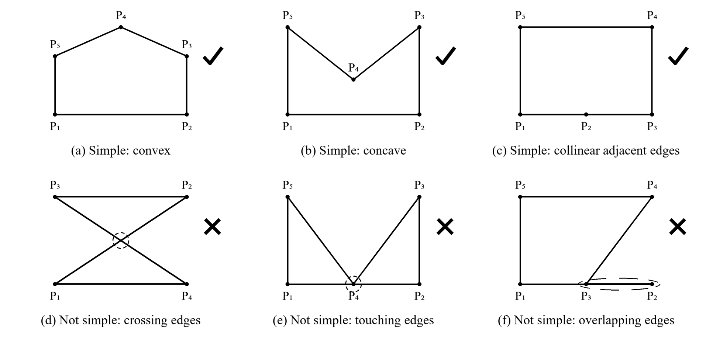
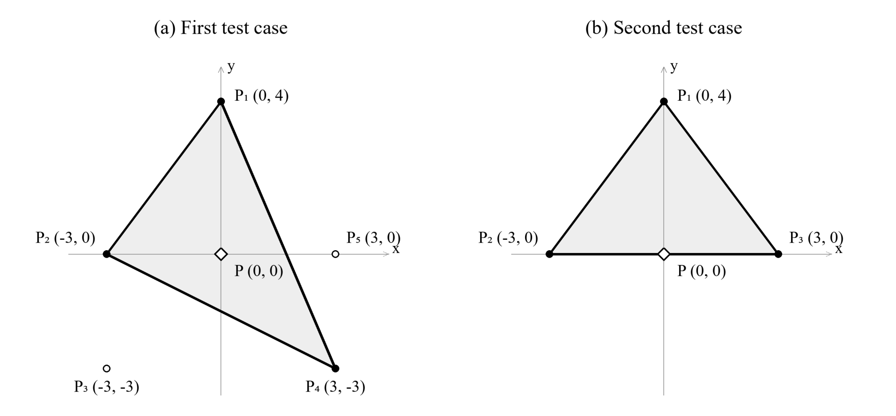

## 题目描述

时间限制：1 秒；内存限制：1024 MB。

平面上有 $n$ 个点 $P_1, P_2, \ldots, P_n$。VegiCat 有 $q$ 次询问。每次询问给出一个点 $P$。


对于每次询问，请使用给定的若干个点作为顶点，构造一个简单多边形。该多边形必须将点 $P$ **严格**包含在内部，并且具有**最少的顶点数**。如果不存在这样的多边形，请输出 $-1$。

简单多边形是由至少三个不同顶点构成的闭合折线。相邻的边仅在它们的公共端点处相交，不相邻的边不相交。



简单多边形与非简单多边形的示例

## 输入格式

第一行包含一个整数 $T$（$1 \le T \le 2 \cdot 10^4$），表示测试用例的数量。接下来是各测试用例的描述。

每个测试用例的第一行包含两个正整数 $n$ 和 $q$（$3 \le n \le 10^5$，$1 \le q \le 10^5$），分别表示给定点的数量和询问的数量。

接下来 $n$ 行中的第 $i$ 行包含两个整数 $x_i$ 和 $y_i$（$-10^9 \le x_i, y_i \le 10^9$），表示点 $P_i$ 的坐标。保证这 $n$ 个点两两不同。

接下来 $q$ 行，每行包含两个整数 $x$ 和 $y$（$-10^9 \le x, y \le 10^9$），表示所询问点的坐标。

保证所有测试用例中 $n$ 的总和不超过 $10^5$。

保证所有测试用例中 $q$ 的总和不超过 $10^5$。

## 输出格式

对于每次询问，如果不存在满足要求的多边形，则在一行中输出一个整数 $-1$。

否则，输出一个顶点数最少的多边形。第一行输出一个整数 $m$，表示顶点数。

第二行按顺序输出 $m$ 个整数 $a_1, a_2, \ldots, a_m$（$1 \le a_i \le n$），表示各顶点的编号。该多边形为 $P_{a_1} P_{a_2} \ldots P_{a_m}$。顶点可以按顺时针或逆时针顺序输出。

顶点编号必须两两不同，且输出的多边形必须是简单多边形并将所询问的点严格包含在内部。如果存在多组解，输出任意一组即可。

## 样例

### 输入格式 1

```text
2
5 1
0 4
-3 0
-3 -3
3 -3
3 0
0 0
3 1
0 4
-3 0
3 0
0 0
```

### 输出格式 1

```text
3
4 1 2
-1
```

### 说明

在第一个测试用例中，三角形 $P_4 P_1 P_2$ 将所询问的点 $P = (0, 0)$ 严格包含在内部。由于多边形至少有三个顶点，因此该三角形具有最少的顶点数。

在第二个测试用例中，唯一可能的多边形是三角形 $P_1 P_2 P_3$。所询问的点 $P = (0, 0)$ 位于边 $P_2 P_3$ 上，因此答案为 $-1$。



样例测试用例的图示

---

来源：[QOJ 中文题面](https://qoj.ac/problem/23596/statement/zh_cn)。保留 QOJ 提供的中文内容，仅转换为 Markdown 排版；原题及图示版权归原作者所有。
