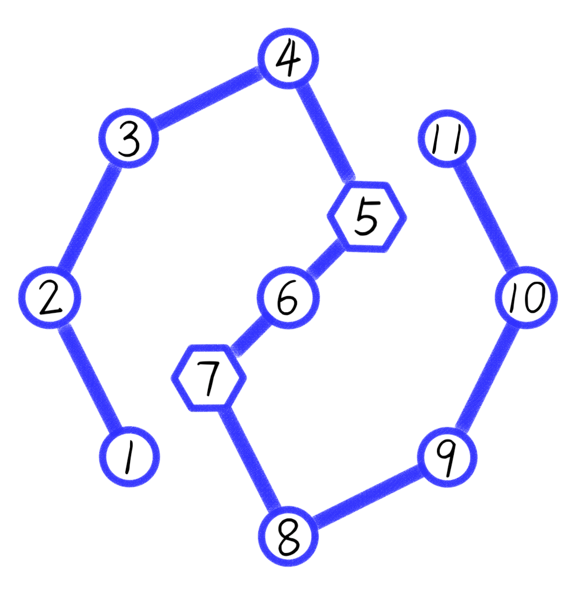
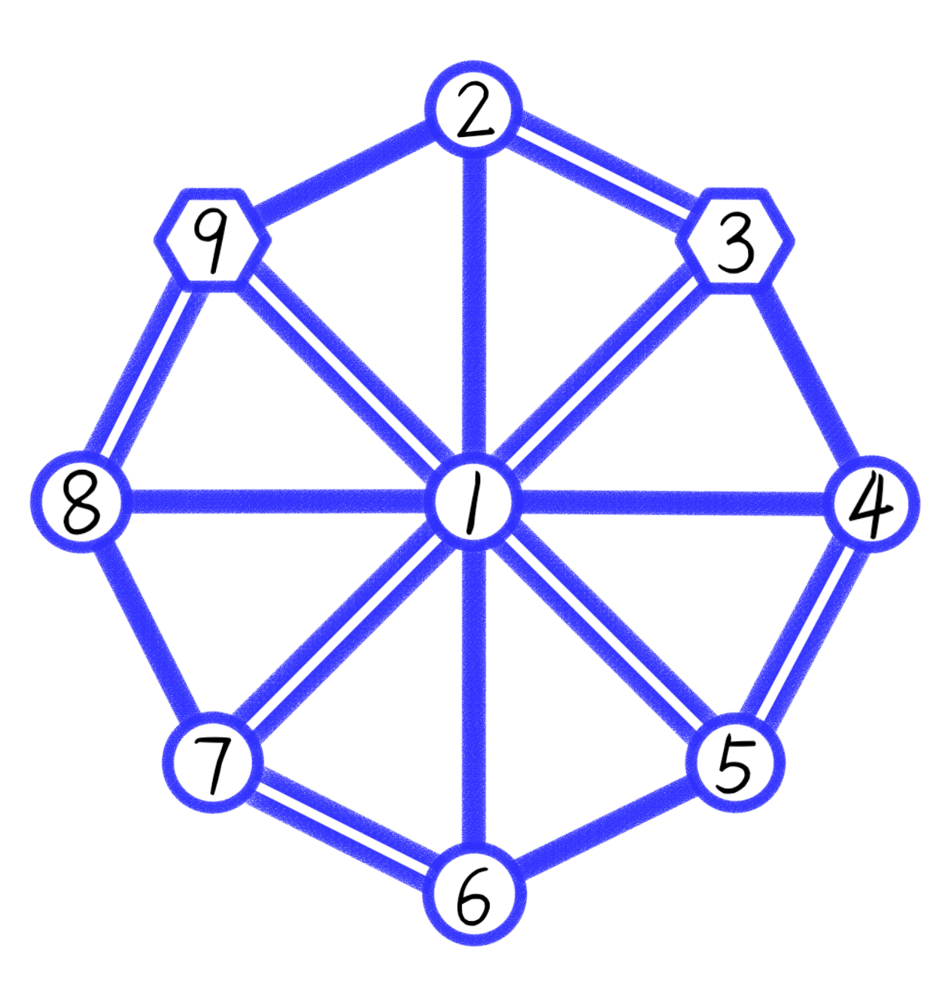

## 题目描述

时间限制：2 秒；内存限制：1024 MB。

Fengmi 最近迷上了一款叫作“一笔画”的小游戏。游戏地图是一张有 $n$ 个顶点和 $m$ 条边的无向图。图中可能有重边、自环，也不一定连通。玩家需要从某个顶点出发，沿图中的边行走，使每条边恰好经过一次，最终可以停在任意顶点。当所有边都恰好经过一次时，游戏立即结束。

游戏加入了特殊的“传送”机制：有 $k$ 对互不重叠的“跳跃点”。对于每一对 $(a,b)$，每当玩家沿一条边到达顶点 $a$ 或 $b$ 时，就会立即被传送到这一对中的另一个顶点，然后从那里继续行走。

特别注意：

- 起点不会触发传送，即使起点是跳跃点，出发时也不发生传送。
- 终点也不会触发传送，即使最后一步到达跳跃点，游戏也会立即结束，不再发生传送。

Fengmi 想知道，是否存在一条路线，使玩家从某个顶点出发，恰好经过每条边一次，并严格遵守上述跳跃规则。如果存在，请输出任意一条这样的路线，用访问的顶点序列表示；否则报告无解。

## 输入格式

第一行包含一个正整数 $t$（$1\le t\le5\times10^4$），表示测试数据组数。对于每组测试数据：

第一行包含三个正整数 $n,m,k$（$2\le n\le10^5$，$1\le m\le10^6$，$1\le k\le\lfloor n/2\rfloor$），分别表示顶点数、边数和跳跃点对数。

接下来 $m$ 行，每行包含两个整数 $u_i,v_i$（$1\le u_i,v_i\le n$），描述一条无向边。图中可能存在重边和自环。

接下来 $k$ 行，每行包含两个整数 $a_i,b_i$（$1\le a_i,b_i\le n$，$a_i\ne b_i$），表示一对跳跃点。保证所有 $a_i,b_i$ 两两不同，即每个顶点至多属于一对跳跃点。

保证所有测试数据中 $n$ 的总和不超过 $10^5$，$m$ 的总和不超过 $10^6$。

## 输出格式

对于每组测试数据，如果存在符合要求的路线，第一行输出一个整数 $L$，表示访问的顶点数，包括起点和终点；第二行输出 $L$ 个用空格分隔的整数，表示依次访问的顶点编号。

如果不存在，输出一行 `-1`。

路线序列必须记录实际到达的顶点，包括传送后到达的顶点。例如，从顶点 $1$ 走到 $2$，若 $2$ 是跳跃点并传送到 $3$，然后从 $3$ 走到 $4$，则输出序列应为 $[1,2,3,4]$。

## 样例

### 输入

```text
2
11 10 1
1 2
2 3
3 4
4 5
5 6
6 7
7 8
8 9
9 10
10 11
5 7
9 24 1
1 2
1 3
1 3
1 4
1 5
1 5
1 6
1 7
1 7
1 8
1 9
1 9
2 3
2 3
3 4
4 5
4 5
5 6
6 7
6 7
7 8
8 9
8 9
9 2
9 3
```

### 输出

```text
13
1 2 3 4 5 7 6 5 7 8 9 10 11
30
5 6 7 8 9 3 4 5 4 1 9 3 2 9 3 2 1 9 3 1 8 9 3 1 7 6 1 5 1 7
```

## 说明

第一组测试数据中，$(5,7)$ 是一对跳跃点，如图所示。



一条合法路线为：$1\to2\to3\to4\to5$（传送）$\to7\to6\to5$（传送）$\to7\to8\to9\to10\to11$。

第二组测试数据的图如下：


