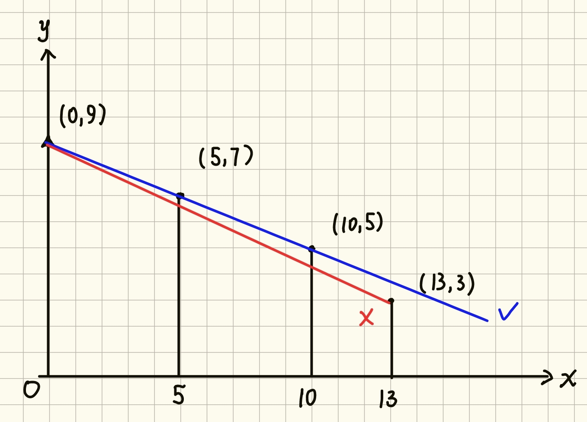

## 题目描述

时间限制：2 秒；内存限制：1024 MB。

在 2077 年的赛博朋克都市`波普特''，机密数据的传输无法依赖公共网络，而是依靠顶层黑客们建立的`直线微波通信''网络。

黑客橙冰控制着一台可以在中心数据塔上垂直移动的信号中继无人机。我们将中心数据塔所在的垂直线视为坐标系的 $Y$ 轴（即 $X=0$）。城市的天际线由 $N$ 栋摩天大楼组成，为了简化模型，<strong>我们将第 $i$ 栋大楼视为一条底部在 $X$ 轴正半轴上、顶部坐标为 $(X_i, H_i)$ 的垂直线段</strong>。

当无人机停留在中心塔的高度 $Y$（即坐标为 $(0, Y)$）时，它会尝试向所有大楼的顶部节点发送连接光束。如果无人机到第 $i$ 栋大楼顶部 $(X_i, H_i)$ 的直线段<strong>没有被任何更靠近中心塔的大楼阻挡</strong>，则认为该大楼的节点是<strong>可见的</strong>并能成功建立连接。

视线可以擦过大楼的顶部，但不能穿过大楼的主体。严格来说，第 $i$ 栋大楼对处于 $(0, Y)$ 的无人机是可见的，当且仅当对于任意横坐标满足 $0 < X_j < X_i$ 的大楼 $j$，从无人机看向大楼 $i$ 顶部的视线斜率，<strong>不小于</strong>看向大楼 $j$ 顶部的视线斜率。

例如下图中，无人机位于 $(0, 9)$，第一栋和第二栋大楼顶端与无人机三点一线，换言之，从无人机看向两栋大楼顶端的视线斜率相同，此时我们认为<strong>两栋大楼都可以被看见</strong>。但从无人机看向第三栋大楼顶端的视线斜率比前两栋小，因此无法被看见。



注意：同一个横坐标 $X$ 上的空间只够建造最多一栋大楼。换言之，大楼的横坐标一定是互不相同的。

今晚，黑客橙冰需要执行 $Q$ 次扫描任务。在第 $k$ 次任务中，无人机会移动到高度 $Y_k$。请你帮他编写程序，计算每次扫描中，无人机最多能与多少栋大楼的节点成功建立连接。

## 输入格式

第一行包含两个整数 $N$（$1 \le N \le 2\times 10^5$）和 $Q$（$1 \le Q \le 2\times 10^5$），分别表示摩天大楼的数量和扫描任务的次数。

接下来 $N$ 行，每行包含两个整数 $X_i$（$1 \le X_i \le 10^6$）和 $H_i$（$1 \le H_i \le 10^6$），表示第 $i$ 栋摩天大楼的横坐标和高度。保证所有 $X_i$ 两两不同。

接下来 $Q$ 行，每行包含一个整数 $Y_k$（$1 \le Y_k \le 10^{12}$），表示第 $k$ 次扫描时无人机所在的高度。

由于输入数据量较大，建议使用较快的输入输出方式。

## 输出格式

输出共 $Q$ 行，第 $k$ 行输出一个整数，表示无人机在高度 $Y_k$ 时能够看到的大楼数量。

## 样例

### 输入格式 1

```text
3 2
10 10
20 20
30 21
19
16
```

### 输出格式 1

```text
3
2
```

### 说明

在样例中，共有 $3$ 栋大楼，坐标分别为 $(10, 10)$、$(20, 20)$ 和 $(30, 21)$。 通过计算遮挡阈值可知，第二栋楼在 $Y > 0$ 时对第一栋可见；第三栋楼在 $Y > 18$ 时对前两栋可见。

第一次查询 $Y = 19$：

-   看向第一栋大楼的斜率为 $(10 - 19) / 10 = -0.9$
-   看向第二栋大楼的斜率为 $(20 - 19) / 20 = 0.05$
-   看向第三栋大楼的斜率为 $(21 - 19) / 30 \approx 0.067$

此时 $-0.9 < 0.05 < 0.067$，没有任何大楼被遮挡，因此输出 $3$。

第二次查询 $Y = 16$：

-   看向第一栋大楼的斜率为 $(10 - 16) / 10 = -0.6$
-   看向第二栋大楼的斜率为 $(20 - 16) / 20 = 0.2$
-   看向第三栋大楼的斜率为 $(21 - 16) / 30 \approx 0.167$

此时第一栋和第二栋大楼可见，但由于 $0.167 < 0.2$，第三栋大楼被第二栋大楼完全遮挡在阴影中（因为 $Y=16 \le 18$ 未达到可见阈值），因此输出 $2$。
