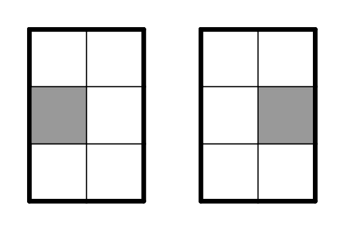
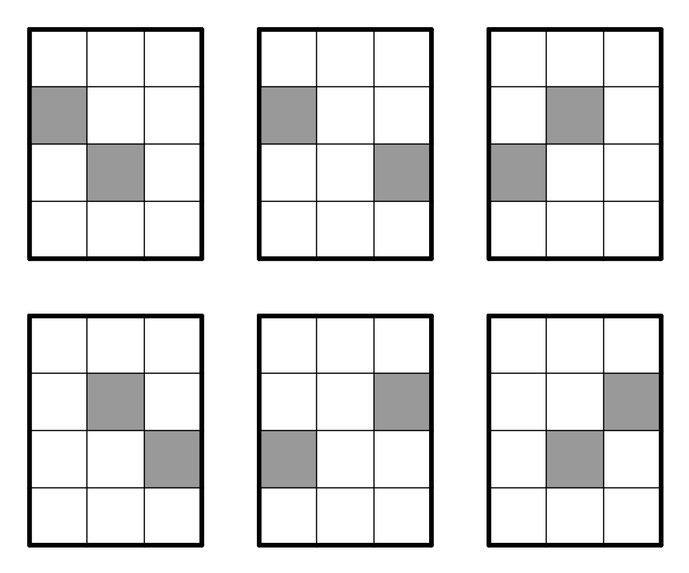

> QOJ 将此版本标注为 AI 翻译，可能存在不准确之处；有疑问时请核对原文。

## 题目描述

时间限制：1 秒；内存限制：512 MB。

这是该问题的困难版本。简单版本和困难版本之间唯一的区别在于对你解决方案中移动步数的限制。

Yuki 生活在一个有 $n+1$ 行和 $n$ 列的网格上。行从上到下依次编号为 $1$ 到 $n+1$，列从左到右依次编号为 $1$ 到 $n$。用 $(i, j)$ 表示第 $i$ 行第 $j$ 列的单元格。网格上有 $n - 1$ 个障碍物，它们的分布满足以下条件：

-   第 $1$ 行和第 $n + 1$ 行没有障碍物。
-   对于所有 $2 \le i \le n$，第 $i$ 行恰好有一个障碍物。
-   对于所有 $1 \le j \le n$，第 $j$ 列至多有一个障碍物。

最初，Yuki 位于 $(1, 1)$。她听说有一群袋鼠生活在第 $n + 1$ 行，所以她想去第 $n + 1$ 行看风景。

为了达到她的目标，Yuki 可以进行若干次移动。在每次移动中，她选择四个方向（上、下、左、右）之一，并向该方向移动一个单元格。具体来说，如果目标单元格在网格外部或包含障碍物，则该移动不会被执行。

不幸的是，Yuki 只知道障碍物分布的规则，而不知道障碍物的具体位置。因此，她希望你帮她指定一个移动序列，使得对于任何合法的障碍物分布，Yuki 都能在某个时刻到达第 $n + 1$ 行（她只需要至少到达过一次第 $n + 1$ 行即可；在所有移动完成后，她不需要留在那里）。

由于 Yuki 赶时间，你解决方案中的移动步数不能超过 $10 \cdot n$。

## 输入格式

单行包含一个正整数 $n$（$2 \le n \le 10^3$）。

## 输出格式

第一行输出一个整数 $k$（$1 \le k \le 10 \cdot n$），表示你解决方案中的移动步数。

第二行输出一个长度为 $k$ 的字符串 $s$，其中 $s_i$ 表示 Yuki 第 $i$ 次移动的方向：

-   如果 $s_i = \text{U}$，Yuki 向上移动。
-   如果 $s_i = \text{D}$，Yuki 向下移动。
-   如果 $s_i = \text{L}$，Yuki 向左移动。
-   如果 $s_i = \text{R}$，Yuki 向右移动。

## 样例

### 输入样例 1

```text
2
```

### 输出样例 1

```text
4
DRDD
```

### 输入样例 2

```text
3
```

### 输出样例 2

```text
17
DDDUUURDDDUUURDDD
```

## 说明

对于第一个样例：

-   设灰色单元格表示障碍物，白色单元格表示空单元格。下图显示了满足要求的所有可能障碍物分布：
    
    
    
-   对于第一种障碍物分布，Yuki 的路径为 $(1, 1) \to (1, 1) \to (1, 2) \to (2, 2) \to (3, 2)$。
    
-   对于第二种障碍物分布，Yuki 的路径为 $(1, 1) \to (2, 1) \to (2, 1) \to (3, 1) \to (3, 1)$。
-   对于每种合法的障碍物分布，Yuki 都会到达第 $n + 1$ 行，因此样例输出是正确的。

对于第二个样例：

-   设灰色单元格表示障碍物，白色单元格表示空单元格。下图显示了满足要求的所有可能障碍物分布：
    
    
    
-   易证对于这些障碍物分布中的任何一种，按照样例输出中给出的移动，Yuki 都会到达第 $n + 1$ 行。
